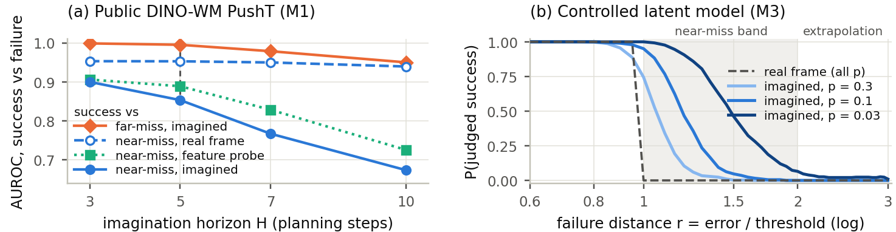

# Near-Miss Blindness

**Latent World-Model Imagination Loses Resolution at the Outcome Boundary**

YongHwi Song (School of Information and Communication Engineering) and Keon Myung Lee (School of Software), Chungbuk National University

Code, results and reports behind the paper. The two-page version for the JKAIA 2026 poster track is in [paper/jkaia2026/](paper/jkaia2026/); a full-length version is in preparation.

## Summary

World models used to evaluate robot policies have been reported to imagine success for failed executions. We ask which failures are misjudged. Counterfactual failures are generated densely around the success boundary and indexed by the failure distance r = e/τ, the task error over the success threshold (success r < 1, near miss 1 ≤ r < 2, far miss r ≥ 3). Real and imagined final frames are scored by the same judge, which separates judge error from imagination error.

- **Public DINO-WM PushT (M1), horizon 5.** Imagination still separates success from far misses but loses resolution at the boundary. The success vs. near-miss AUROC falls from 0.953 on real frames to 0.853 in imagination; the success vs. far-miss AUROC falls by only 0.005. The near-miss drop grows with the horizon. A probe trained on imagined features reaches only 0.889, so part of the boundary information is lost. The errors are two-sided rather than optimistic.
- **Controlled latent model (M3).** Lowering the training failure rate from 0.3 to 0.03 raises the share of near misses imagined as success from 0.10 to 0.54, all of it added by imagination, while success misjudgments fall to zero.
- **Remedies.** A training-free MC dropout discount helps only slightly on M1. In both latent models, boundary-targeted counterfactual data did not outperform simple reweighting.
- **Video world model (Cosmos Policy on LIBERO, M2).** The pre-registered boundary-specific hypotheses were not supported, so the claims are limited to the two latent models.

| Pre-registered quantity (judge (a), primary cell) | M1 PushT, H = 5 | M2 LIBERO | M3, p = 0.03 |
|---|---|---|---|
| Near-miss judged success: real → imagined | 0.112 → 0.147 | 0.051 → 0.298 | 0.000 → 0.535 |
| AUROC drop, success vs. near / vs. far | 0.100 / 0.005 | 0.275 / 0.137 | 0.107 / 0.000 |
| H1a (near ≥ 0.3, ≥ 3× far) / H1b (near-specific loss) | no / yes | no / no | yes / 2 of 3 clauses |
| H3: imagination share of near-miss errors > 0.5 | 0.24, no | 0.83, yes | 1.00, yes |
| H2a: Spearman(n_π, o_π^imag) ≥ 0.6 | 0.36, no | not run | 0.83, yes |

The primary hypotheses H1a, H1b and H2a each hold in one model only and fail the two-model rule. The exploratory H3 holds in M2 (with a judge caveat) and in M3. The full account is in [main/reports/FINAL_B.md](main/reports/FINAL_B.md).

## Repository layout

| Path | Contents |
|---|---|
| [EXPERIMENT_DESIGN.md](EXPERIMENT_DESIGN.md) | Experiment design: hypotheses, metrics and decision rules |
| [main/DESIGN_main.md](main/DESIGN_main.md) | Design frozen before the main runs, with dated amendments |
| [main/code/server/](main/code/server/) | Code run on the university GPU server (M1; M3 in `m3/`) |
| [main/code/runpod/](main/code/runpod/) | Code run on RunPod pods (M2) |
| [main/results/](main/results/) | Results per stage (E0 to E5): JSON, CSV and small PNGs |
| [main/reports/](main/reports/) | Stage reports and the final summary `FINAL_B.md` |
| `main/LOG.md`, `main/worklogs/` | Chronological run logs |
| [pilots/](pilots/) | Five feasibility pilots, each with `PLAN.md` (written before the run), `LOG.md`, `code/`, `results/` and `REPORT.md` |
| [paper/](paper/) | JKAIA 2026 poster source and PDF, figure and number-check scripts, Korean explainer |
| [workspace/](workspace/) | Copies of files from the parent research folder that documents here link to |
| [STUDY_GUIDE.md](STUDY_GUIDE.md) | Background and a walkthrough of the experiments |

Designs, logs and reports are written in Korean; code and comments are in English.

## Pre-registration

Hypotheses, metrics, thresholds and decision rules were fixed before the runs: in `EXPERIMENT_DESIGN.md` and `main/DESIGN_main.md` for the main experiments (later amendments are dated) and in `pilots/*/PLAN.md` before each pilot. Negative results are reported.

These files are kept unmodified, so a few of their links point above this folder (to `../archive/`, `../literature/` or `../runpod_infra/`). The linked files are under [workspace/](workspace/) with the same relative paths. This repository was assembled on 2026-10-30, after the runs, so its git history does not timestamp these documents.

## Reproducing

The code is the code that was run, organized by stage rather than packaged as a library. Each stage report in `main/reports/` says what was run. Setup notes are in the E0 reports (`E0_server.md`, `E0_runpod.md`) and in `main/LOG.md`.

- **Check the paper's numbers** (seconds, CPU only). `python3 paper/build/verify_numbers.py` reads `main/results/` and compares every number in the poster with the result files. `python3 paper/build/make_figs.py` redraws the figure.
- **Hardware.** M1 and M3 ran on one RTX A5000 (24 GB) in an Ubuntu 22.04 container. M2 ran on RunPod A40 pods.
- **Upstream code.** These repositories were cloned at setup and are not included here.

| Repository | Commit | Used for |
|---|---|---|
| [gaoyuezhou/dino_wm](https://github.com/gaoyuezhou/dino_wm) | `0a9492f` | M1: the public PushT world model |
| [real-stanford/diffusion_policy](https://github.com/real-stanford/diffusion_policy) | `5ba07ac` | Diffusion Policy for the evaluated policies |
| [nvlabs/cosmos-policy](https://github.com/nvlabs/cosmos-policy) | `18a2acc` | M2: the video world model and policy |
| [huggingface/lerobot-libero](https://github.com/huggingface/lerobot-libero) | `14fd6f0` | M2: the LIBERO environment |
| [jiuyixu25/CureWM](https://github.com/jiuyixu25/CureWM) | `8a7ee5d` | M2: counterfactual queries and a reproduction of its optimism result |

M3 is implemented in `main/code/server/m3/`.

## Data not in git

The raw E0b counterfactual records (`main/results/E0b_runpod/{cf_json,cf_json_v2,e0b_validate,e0b_validate_v2}/`, about 14,800 JSON files) and the cached DINO features (`main/results/E0b_runpod/b-e0_results/judge_a/dino_feats.npz`, 73 MB) are not tracked. They are distributed as the release asset `E0b_runpod_raw.tar.gz`; the paper's number check does not read them. Model checkpoints and datasets are not stored here.

## License

The code is released under the MIT License ([LICENSE](LICENSE)). `paper/jkaia2026/kaia.cls` is the JKAIA 2026 template and is not covered by it. Upstream repositories keep their own licenses.

## Citation

Citation metadata is in [CITATION.cff](CITATION.cff).
