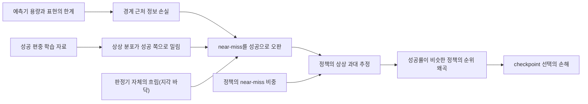
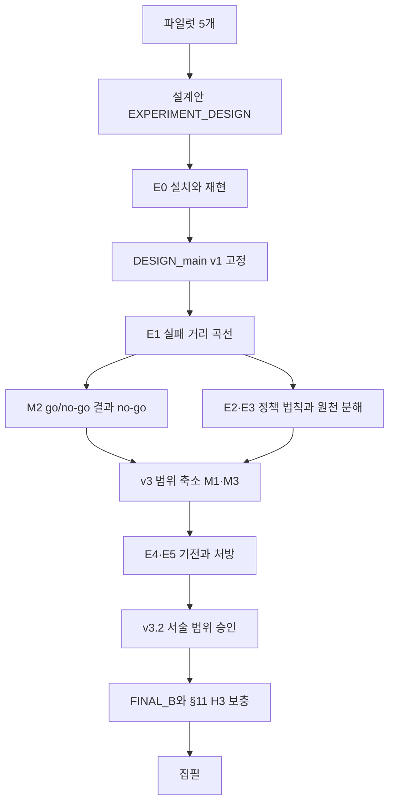

# Near-Miss Blindness 학습 노트

이 노트는 B 논문 *Near-Miss Blindness*를 처음부터 공부하기 위한 정리다. 배경 개념, 아이디어, 실험을 어떻게 돌렸는지, 무엇이 나왔는지, 주장이 왜 바뀌었는지를 차례로 적었다. 기준 시점은 2026-10-23이고, 뼈대는 최종 종합 보고 `main/reports/FINAL_B.md`다.

> **주의**
> 숫자 뒤 괄호는 출처 문서와 절이다. 예: (FINAL_B §2), (E4E5 §2.2).
> 줄임말: 설계안 = `EXPERIMENT_DESIGN.md`, DESIGN_main = `main/DESIGN_main.md`(사전등록 문서), FINAL_B = `main/reports/FINAL_B.md`, E0b = `E0b_runpod.md`, E2E3 = `E2E3_server.md`, E4E5 = `E4E5_server.md`. 나머지 단계 보고(E0_server, E0_runpod, E1_server, E1_m2)는 파일 이름 그대로 쓴다.
> [a, b]는 95% 신뢰구간, %p는 퍼센트포인트다. 조건부 확률의 세로선은 ∣로 쓴다. P(Ŝ = 1 ∣ near)는 "near-miss일 때 성공으로 판정될 확률"이다.
> 이 노트는 새 계산을 하지 않았다. 수치는 모두 기존 문서에서 옮겼고, 설명을 위해 지어낸 숫자에는 "가상의 예"라고 붙였다.

## 한 장 요약

- **문제.** 로봇 정책을 실제 로봇 대신 월드모델 안에서 굴려 평가하고 고르는 일이 늘고 있다. 월드모델이 실패를 성공으로 그린다는 보고는 많지만, *어떤* 실패를 그렇게 그리는지, 그것이 정책 평가를 어떻게 비트는지는 재지 않았다 (설계안 §0·§1).
- **아이디어.** 상상은 성공 경계 바로 바깥, 즉 아깝게 실패한 경우(near-miss)의 정보를 가장 먼저 잃는다. 그러면 상상이 실패를 성공으로 볼 확률은 실패가 경계에서 얼마나 먼지(실패 거리 r)의 함수가 되고, 정책 평가 오차는 성공률이 아니라 정책의 near-miss 비중을 따른다 (설계안 §0).
- **모델 셋.** M1 공개 DINO-WM PushT(대학 서버), M2 Cosmos Policy LIBERO(RunPod), M3 직접 만든 통제 latent 모델(대학 서버). 선택 모델 M4(Ctrl-World)는 하지 않았다 (FINAL_B §1.1).
- **결과 1: 경계 해상도 손실(M1).** 성공과 near-miss를 가르는 AUROC가 실제 프레임 0.953에서 상상 0.853으로 떨어진다(Δ 0.100 [0.075, 0.125]). 성공과 far-miss 사이는 0.005만 떨어진다. 손실은 상상이 길수록 커지고, 상상 특징으로 직접 학습한 판별기도 0.889에 그쳐 정보 자체가 줄었다 (FINAL_B §0).
- **결과 2: 성공 편중이 흐림을 낙관으로 바꾼다(M3).** 학습 자료의 실패율을 0.3 → 0.1 → 0.03으로 낮추면 near-miss를 성공으로 보는 비율이 0.10 → 0.24 → 0.54로 단조롭게 는다. 정책별 상상 과대 추정은 near-miss 비중을 따른다(Spearman 0.829) (FINAL_B §0).
- **결과 3: 원천과 처방.** near-miss 오판 가운데 상상이 더한 몫이 M2 0.829, M3 1.0이라 H3이 두 모델에서 성립했다(M2에는 판정기 단서). 재학습 없는 MC dropout 할인은 M1의 정책 수준 편향을 줄이지만 효과가 작다(평균 절대 과대 추정 0.0233 → 0.0187) (FINAL_B §0, DESIGN_main §11).
- **M2 no-go와 범위 축소.** Cosmos Policy에서는 near 0.298 < 0.3, near/far 2.52 < 3, 성공 vs far ΔAUROC 0.137 > 0.02로 사전 규칙상 no-go였다. 사용자 승인으로 주장을 latent 월드모델(M1·M3)로 좁혔고 M2 E2와 E6을 뺐다 (E1_m2 §4, DESIGN_main §8).
- **부정 결과와 주장 변경.** 1차 가설군(H1a·H1b·H2a)은 "모델 2개 이상" 기준에서 모두 불성립이다. 경계 겨냥 반사실 자료는 노출량을 맞추면 재가중보다 낫지 않아 처방 주장에서 뺐다(H5a 0/3). 성공률이 비슷한 정책의 순위 역전(H2b)도 없었다. 주장은 사전 규칙과 사용자 승인으로 v2(M3 구간), v3(범위 축소), v3.2(서술 범위), §11(H3 보충)에서 바뀌었다 (FINAL_B §2·§3.2).

## 지금 어디까지 왔나

실험은 모두 끝났다. 본 실험은 2026-10-21 13:00Z에 시작해 10-22 11:40Z에 E4·E5까지 마쳤고(약 22.7시간), 최종 종합 보고 FINAL_B.md는 10-22 13:05Z에 완성됐다 (FINAL_B §7.3, LOG).

| 단계 | 하는 일 | 모델과 장소 | 상태(UTC) | 보고 |
|---|---|---|---|---|
| E0 | 설치, 파일럿 재현, 정책 학습 | M1·M3 대학 서버, M2 RunPod(E0, E0b) | 완료. 서버 10-21 15:45, RunPod E0 14:48, E0b 21:03 | E0_server, E0_runpod, E0b |
| E1 | 실패 거리 곡선(RQ1) | M1·M3 서버, M2 RunPod | 완료. 서버 23:30, M2 10-22 01:00(no-go) | E1_server, E1_m2 |
| E2 | 정책 수준 법칙(RQ2) | M1·M3 서버 | 완료 10-22 03:05. M2 E2는 생략 | E2E3 |
| E3 | 오판의 원천 분해(RQ3) | M1·M3 서버. M2 값은 E1 자료에서 | 완료. M2의 H3 칸은 12:40에 보충 계산 | E2E3, DESIGN_main §11 |
| E4·E5 | 기전(RQ4)과 처방(RQ5) | M1·M3 서버 | 완료 10-22 11:40 | E4E5 |
| E6 | checkpoint 선택 regret(RQ6) | — | 생략(사용자 승인) | DESIGN_main §8 |
| 종합 | 판정 표, 최종 주장, 논문 구성 | 맥북(문서만 읽음) | 완료 10-22 13:05 | FINAL_B |

시각은 DESIGN_main과 LOG를 따랐다. MAIN_STATUS와 몇 분씩 다른 곳이 있지만 모두 해당 평가 전이라 판정에 영향이 없다 (FINAL_B 불일치 D7).

**뺀 것**
- M2 E2(LIBERO 정책 법칙, 약 $15)와 그 뒤의 M2 단계. E1 job이 판정기 (a)·(c)·(d)를 실제·상상 프레임에 모두 적용해서 M2의 판정기 × 입력 값은 남아 있다 (FINAL_B §1.3).
- E6(checkpoint 선택 regret, H6). M1의 정책 수준 편향이 작아서 뺐다 (DESIGN_main §8).
- 선택 모델 M4. 작업 규칙(MAIN_RULES §0)이 미리 허용한 생략이다 (FINAL_B §1.3).

**남은 일: 집필**
- 투고 경로는 워크숍이나 RA-L이다. 병행 후보는 ICRA 2027 워크숍(서울, 5/24~28, 마감은 보통 2~4월)이고 일정은 투고 직전에 다시 확인한다 (DESIGN_main §8, FINAL_B §8.1).
- arXiv는 12월 중순이 목표다. 같은 현상을 다룬 CureWM이 정책 순위를 미검증 과제로 남겨 빨리 내야 한다 (설계안 머리, FINAL_B §8.1).
- 제목 예: *Near-Miss Blindness: Latent World-Model Imagination Loses the Outcome Boundary*. 절 구성과 쓸 그림은 FINAL_B §8.2에 있다.
- FINAL_B §9의 할 일
  - H3 판정을 단서와 함께 본문에 쓰고, 분해 그림에 M2 칸을 넣는다.
  - 서론과 관련 연구를 좁힌 범위에 맞게 다시 쓰고, 2026-10-21 이후 논문을 다시 찾는다.
  - 그림과 표를 기존 JSON만으로 다시 만들고, 부정 결과(M2 no-go, H5a, M1의 H2a·H2b, 1차 가설군 불성립)를 본문에 쓴다.
  - 사전등록 부록(버전별 시각과 sha256, 편차 목록), 다중 비교 단락, 재현 부록을 쓰고, 수치 정의(D4·D5)를 통일한다.

**자원 사용.** RunPod는 $20.27를 썼다(E0 $0.87, E0b $5.82, E1 $13.58). 사용자 상한은 $60, 감시 스크립트 문턱은 $55였고 모든 pod는 지워졌다 (FINAL_B §7.1). 대학 서버는 GPU 1을 약 15.3시간 점유했다(다른 논문 A와 나눠 씀). 설계의 서버 예산은 48 GPU-시간이었다 (FINAL_B §7.2).

## 배경 개념

이 연구를 읽는 데 필요한 개념 15개다. 항목마다 "무엇인가, 여기서 왜 중요한가, 작은 예" 순서로 적었다.

### 1. 월드모델과 상상(latent rollout, horizon H)

**무엇인가.** 월드모델(world model)은 "지금 상태와 행동을 넣으면 다음 상태를 내놓는" 학습된 시뮬레이터다. 이미지를 압축한 특징 벡터(latent) 위에서 다음 특징을 예측하면 latent 월드모델이라 한다. 예측을 다시 입력으로 넣으며 여러 단계를 굴리는 것이 상상(imagination, rollout)이고, 굴린 단계 수가 horizon H다. 실제 관측을 다시 보지 않고 행동열만 넣어 끝까지 굴리면 open-loop 상상이다.

**여기서 왜 중요한가.** 세 모델은 상상의 단위가 다르다.
- M1 DINO-WM은 고정된 DINOv2 patch 특징 위에서 ViT 예측기가 다음 특징을 예측한다. 한 단계가 제어 5 step이라 H = 5는 마지막 25 제어 step이다 (E0_server §4.2·§8.8). H ∈ {3, 5, 7, 10}을 쟀다.
- M2 Cosmos Policy는 16 step짜리 행동 묶음(청크) 단위로 미래 영상을 만든다. k는 이어 붙인 청크 수(1~4)다 (E0_runpod §4.1).
- M3는 4단계 자기회귀 상상으로 고정이다 (DESIGN_main §4).
- 상상이 길수록 오차가 쌓인다. 그래서 H1b에는 "손실이 상상 길이와 함께 커진다"는 조항이 있다.

> **예시**
> 눈을 감고 "공을 이렇게 치면 어디로 갈까"를 머릿속으로 굴린다고 하자. 1초 뒤는 꽤 맞히지만 10초 뒤는 흐릿하다.
> M1에서 H를 3에서 10으로 늘리면 성공과 near-miss를 가르는 AUROC가 0.900에서 0.673으로 떨어진다 (E1_server §3.2).

### 2. 상상 속 정책 평가

**무엇인가.** 정책(로봇 제어기)을 실제 로봇 대신 월드모델 안에서 굴리고, 상상한 결과로 성공률 ŝ_π를 추정하는 일이다. 이 점수로 checkpoint를 고르거나, 월드모델 안에서 강화학습으로 정책을 고친다.

**여기서 왜 중요한가.** 실로봇 평가는 비싸고 느려서 Ctrl-World, WorldGym, Veo 기반 평가, DreamDojo 같은 체계가 나왔다. 보고 지표는 대개 실제 성공률과의 상관(Pearson 0.88~0.99)과 순위 보존이다 (설계안 §1.1). 이 연구의 질문은 "그 점수가 *어떤* 정책에서 틀리는가"다.
- 주 평가 모드는 O(open-loop 재생)다. 실제로 실행한 행동열을 상상에 그대로 넣어 결과 예측만 본다.
- 모드 C(정책이 상상 관측을 보고 행동)는 LIBERO 보조로 계획했지만 M2 E2를 빼면서 돌지 않았다 (DESIGN_main §2의 4.1절, §8).

> **예시**
> M1의 Diffusion Policy checkpoint `s42 ep40`은 실제 성공률 0.60인데 상상에서는 0.67로 평가됐다 (E2E3 §2.1). 이 차이 0.07이 과대 추정 o_π다.

### 3. 성공 판정기와 네 종류

**무엇인가.** 월드모델은 "성공/실패"를 말해 주지 않고 상상한 마지막 프레임(또는 latent)만 낸다. 그것을 성공 여부 Ŝ ∈ {0, 1}로 바꾸는 장치가 판정기(success judge)다. 판정기는 심판과 같아서 화면이 선명해도 스스로 틀릴 수 있다.

| 종류 | 어떻게 판정하나 | 쓴 모델 |
|---|---|---|
| (a) oracle 판별기 | 실제 최종 프레임의 특징과 목표로 학습한 작은 분류기. 실제 프레임 held-out 정확도 ≥ 0.95여야 쓴다 | M1(`a_full`·`a_obj`·`a_std`, 5-seed 앙상블), M2(ResNet-18 CNN, 두 시야), M3(R2-9 고정 판별기) |
| (b) latent 거리 문턱 | 상상 최종 latent와 목표 latent의 평균 제곱 거리 d_vis가 문턱 τ보다 작으면 성공. DINO-WM 계획 비용의 시각 항이다 | M1 dset 목표 집합 |
| (c) value head + 끝 정렬 질의 | Cosmos Policy가 함께 내는 가치 V ∈ [0, 1]가 0.5보다 크면 성공 | M2 |
| (d) VLM | 목표 이미지와 최종 이미지를 보여 주고 같은지 묻는다. 점수는 P(Yes). held AUROC ≥ 0.80이면 판정기, 아니면 보조 | M1(Qwen2.5-VL-7B), M2(7B·32B) |

실제 정확도와 지각 바닥 값은 "본 실험 설계"의 판정기 표에 있다.

**여기서 왜 중요한가.**
- 판정기가 틀리면 월드모델 탓인지 판정기 탓인지 가릴 수 없다. 그래서 설계는 실제 프레임에서 정확한 (a)를 우선한다 (설계안 §4.1).
- M1의 (a)를 앙상블로 정한 이유: 같은 자료로 다시 학습할 때마다 0.5 문턱의 운영점이 흔들렸다. 상상 near 오판율이 0.18~0.26, 정책 Spearman이 0.24~0.69로 움직였고 AUROC만 ±0.003으로 안정했다 (E0_server §2.2).
- (c)의 "끝 정렬": Cosmos의 V는 γ^(남은 step) × 성공(γ = 0.99)을 배운다. V > 0.5는 "약 69 step 안에 성공"이라는 뜻이라, 행동이 갈라지는 시점에 물으면 남은 시간이 판정을 지배한다. 그래서 마지막 k청크만 상상해 끝 무렵에 묻는다 (E0_runpod §4.2·§7).
- M2의 (a)·(d)는 들어 올리기 청크(LIFT: 그리퍼 3 step 열기 + 13 step 위로) 뒤의 프레임을 본다. 그리퍼가 물체를 가리지 않게 하려고 실제와 상상 모두에 붙인다 (E0b §5).
- M1의 (d)는 latent를 VQ-VAE decoder로 224 px 이미지로 되돌려 보여 준다. 실제 프레임도 같은 encode → decode를 거친다 (DESIGN_main §7).

> **예시**
> 파일럿 R2-12에서 판정기 (b)는 상상에서 near-miss의 38.3%를 성공으로 봤다. 그런데 실제 프레임을 줘도 이미 28.3%를 성공으로 봤다. 대부분이 판정기 자신의 흐림이었다 (R2-12 REPORT §1).

### 4. 지각 바닥과 상상 몫

**무엇인가.** 축구의 비디오 판독을 떠올리면 쉽다. 심판의 눈이 원래 나빠서 틀리는 몫과, 판독 화면이 흐려서 틀리는 몫은 다르다.
- 지각 바닥(perception floor): 실제 최종 프레임을 줬을 때 판정기가 near-miss를 성공으로 보는 비율 P_실제(near). 상상이 없어도 생기는 오판이다.
- 상상 몫: 상상 프레임의 near-miss 오판 가운데 상상이 더한 비율이다.

```
상상 몫 = (P_상상(near) − P_실제(near)) / P_상상(near)

정책 수준 분해 (같은 판정기, 같은 창)
o_π       = ŝ_π − s_π            ← 전체 과대 추정
o_π^imag  = ŝ_π − ŝ_π^real       ← 상상 몫
o_π^judge = ŝ_π^real − s_π       ← 판정기 몫
```

s_π는 실제 성공률, ŝ_π는 상상 판정 성공률, ŝ_π^real은 같은 판정기를 실제 최종 프레임에 쓴 성공률이다 (DESIGN_main §2의 4.3절, §7).

**여기서 왜 중요한가.** "월드모델이 정보를 잃었다"와 "판정기가 원래 흐렸다"를 가르는 장치다. H3(RQ3)이 이 비율로 판정되고, 설계는 모든 판정기의 지각 바닥을 먼저 보고하게 했다 (설계안 §6.0).

> **예시**
> H3 주 칸의 값이다 (E2E3 §4.4, DESIGN_main §11).
> M1: 지각 바닥 0.112, 상상 0.147, 상상 몫 0.239. 오판 대부분이 판정기에서 온다.
> M2: 0.051에서 0.298로, 상상 몫 0.829. M3: 0.000에서 0.535로, 상상 몫 1.000. 오판 대부분 또는 전부가 상상에서 온다.

### 5. 실패 거리 r = e/τ와 구간

**무엇인가.** "얼마나 아깝게 실패했나"를 숫자 하나로 만든 것이다. 과제마다 연속 오차 e를 미리 정하고 성공 문턱 τ로 나눈다. r < 1이면 성공이다.

```
r = e / τ          (r < 1 이면 성공)

구간 (보조)
성공   r < 1
near   1 ≤ r < 2    ← 경계 바로 바깥, near-miss
mid    2 ≤ r < 3
far    r ≥ 3        ← 크게 벗어난 실패, far-miss

PushT(M1)의 두 정의
r     = max( ‖Δ(agent, block) xy‖₂ / 20 px ,  |Δθ| / (π/9) )
r_obj = max( ‖Δblock xy‖₂ / 20 px ,           |Δθ| / (π/9) )
```

주 분석은 구간이 아니라 연속 곡선 P(Ŝ = 1 ∣ r)이다(log r 로지스틱). M3에는 R2-9의 정렬비 구간 [1, 1.2)도 보조로 둔다 (DESIGN_main §2의 4.1절).

| 모델 | e와 τ | 메모 |
|---|---|---|
| M1 원 정의 r | agent와 T 블록의 위치 오차 / 20 px, 각도 오차 / π/9(20°) 중 큰 것 | PushT 평가기 eval_state와 같다 |
| M1 r_obj | 블록 위치 오차 / 20 px와 각도 오차 / (π/9) 중 큰 것. agent는 무시 | 표준 PushT로 돈 DP episode에는 r_obj만 정의된다 |
| M2 | 예: t8 그릇과 접시의 수평 거리 / 3 cm, t1 스토브 영역 오프셋 / 반폭 7.5 cm | 마지막 행동 뒤 15 step 정착한 상태에서 잰다 |
| M3 | 정렬 오차의 크기 / 물체 반폭 w | 학습 실패는 r ∈ [1, 2)뿐이라 r ≥ 2는 외삽이다 |

표는 DESIGN_main §0.2~§0.4와 E0b §5에서 옮겼다.

**여기서 왜 중요한가.** r이 있어야 "어떤 실패를 성공으로 보는가"를 곡선으로 그릴 수 있다. r_obj를 따로 둔 이유: 원 정의의 near-miss는 85%가 agent 위치 오차가 지배한다(E1 val H5에서 1,161개) (E1_server §3.1). 판정기가 작은 agent 위치 차이를 잘 못 봐서 지각 바닥이 커지는데, r_obj는 이 혼입을 뺀다.

> **예시**
> 가상의 예: T 블록이 목표 자리에서 30 px 벗어났고 각도와 agent는 맞다면 r_obj = 30 / 20 = 1.5로 near-miss다.
> 실제 예: R2-9의 π6 near-failer는 절반은 성공하고 나머지는 모두 r ∈ [1.0, 1.2)에서 아깝게 실패하는 정책이다. π5 far-failer는 성공률이 같지만 실패가 r ∈ [1.5, 2.0)에 있다 (R2-9 PLAN §5).

### 6. near-miss 낙관과 양방향 흐림

**무엇인가.** 실제 결과는 r = 1에서 성공과 실패가 칼같이 갈리는 계단이다. 상상은 이 계단을 두 방식으로 망가뜨릴 수 있다.
- 낙관(optimism): 경계가 바깥으로 밀린다. near-miss가 성공으로 보이고 실제 성공은 그대로다. 정책 성공률이 부풀려진다.
- 양방향 흐림(two-sided blur): 계단이 완만한 비탈이 된다. near-miss 일부는 성공으로, 실제 성공 일부는 실패로 보인다. 순 편향이 비관일 수도 있다.
- 곡선으로 보면, 상상 성공 확률이 0.5가 되는 r₅₀이 안쪽으로, 0.1이 되는 r₁₀이 바깥으로 움직이면 흐림이다. Δr₁₀ = r₁₀(상상) − r₁₀(실제)는 상상이 꼬리를 얼마나 밀어냈는지다 (DESIGN_main §2의 4.3절).

**여기서 왜 중요한가.** 공개 M1의 순 편향은 비관이라 "월드모델은 낙관적이다"라고 쓰면 틀린다. 그래서 M1은 "양방향 흐림"과 "경계 해상도 손실"로, M3는 "낙관"으로 쓴다 (FINAL_B §3.1). 무엇이 흐림을 낙관으로 바꾸는지가 H4a의 질문이다. 파일럿 R2-12는 판정기를 어디에 맞췄는지도 방향을 바꾼다고 봤다. 상상 특징에 맞춰 학습한 판별기로 보면 R2-9 같은 낙관 모양(ρ 0.97)이 나왔다 (R2-12 REPORT §3).

**작은 예.** 같은 질문에 대한 두 모델의 답이다 (E1_server §3.1·§4).

| 상상 판정 | M1 (val, H5, 원 정의 r) | M3 (p = 0.03) |
|---|---|---|
| 실제 성공을 성공으로 본 비율 | 0.710 (실제 프레임 0.862) | 1.000 |
| near-miss를 성공으로 본 비율 | 0.147 (실제 프레임 0.112) | 0.535 (실제 프레임 0.000) |
| r₅₀ | 상상 0.90, 실제 1.03(안쪽으로) | 상상 1.51(바깥으로) |
| Δr₁₀ | 0.21 | 0.95 |
| 모습 | 양방향 흐림, 순 편향 비관 | 낙관 |

### 7. AUROC와 ΔAUROC

**무엇인가.** 판정기 점수가 두 무리(예: 성공 대 near-miss)를 얼마나 잘 가르는지 재는 값이다. "무작위로 뽑은 성공 하나가 무작위로 뽑은 near-miss 하나보다 높은 점수를 받을 확률"로 보면 된다. 0.5는 동전 던지기, 1.0은 완벽이고, 문턱을 정할 필요가 없다. ΔAUROC = AUROC_실제 − AUROC_상상은 상상이 잃은 판별력이다.

**여기서 왜 중요한가.**
- 경계 해상도: 성공 대 near와 성공 대 far를 따로 잰다. near 쪽만 크게 떨어지면 "near-miss 특이적" 손실이고, 이것이 H1b다.
- 운영점과 보정(calibration): "near를 성공으로 본 비율" 같은 값은 문턱 위치에 달렸다. AUROC가 같아도 문턱이 조금 움직이면 비율이 크게 변한다. M1의 (a)를 앙상블로 정한 것도 이 때문이다.
- 정보 상한: 상상 특징으로 *직접* 학습한 판별기(상한 판별기, R2-12의 D3)의 AUROC다. 판정기를 상상에 새로 맞춰도 못 가르면 정보 자체가 사라진 것이다. H4b가 이 값으로 판정된다.

> **예시**
> M1, H5, 원 정의 r (E1_server §3.1).
> 성공 대 near: 실제 0.953에서 상상 0.853으로, ΔAUROC 0.100. 상한 판별기도 0.889다.
> 성공 대 far: 실제 1.000에서 상상 0.995로, ΔAUROC 0.005. 먼 실패는 상상에서도 잘 가르지만 아까운 실패는 잘 못 가른다.

### 8. Spearman, Kendall τ_b, Pearson, MMRV

**무엇인가.** 두 목록이 얼마나 닮았는지 재는 방법들이다.

| 지표 | 직관 | 이 연구에서 쓰인 곳 |
|---|---|---|
| Pearson | 값끼리 직선 관계가 얼마나 강한가 | H2c: 상상 대 실제 성공률의 Pearson ≥ 0.8이면 "좋아 보인다" |
| Spearman ρ | 순위끼리의 Pearson. 단조 관계를 본다 | H2a: Spearman(n_π, o_π^imag) ≥ 0.6 |
| Kendall τ_b | 쌍마다 두 순서가 같은 방향인 비율에서 반대 방향인 비율을 뺀 값(동점 보정) | H2b: 실제 성공률 차 ≤ 5%p인 쌍들의 τ_b ≤ 0.5 |
| MMRV | 순위가 뒤집힌 쌍에 실제 성공률 차만큼 벌점을 주고, 정책마다 가장 큰 벌점을 평균 | H2c: MMRV ≤ 0.05이면 "좋아 보인다" |

```
MMRV = (1/N) Σ_i  max_j  |s_i − s_j| · 1[ (ŝ_i < ŝ_j) ≠ (s_i < s_j) ]

1[...] 는 괄호 안이 참이면 1, 거짓이면 0
```

위 MMRV 식은 SIMPLER 논문의 정의를 옮긴 것이다. 프로젝트 문서에는 "SIMPLER 정의"라고만 적혀 있다.

**여기서 왜 중요한가.** MMRV는 벌점이 실제 성공률 차이에 비례해서, 실력이 비슷한 정책 사이의 역전에 관대하다. 그런데 이 연구가 걱정하는 역전은 바로 그런 정책 사이에서 생긴다. R2-9에서 실제 52.6% 대 48.2%인 정책이 상상에서 98.5% 대 58%로 갈려도 MMRV 벌점은 거의 없다 (설계안 §2.1). 이 맹점을 보이려는 것이 H2c이고, 고치려는 지표가 FGRE다.

> **예시**
> M1 DP 24개: Pearson 0.998, MMRV 0.010으로 아주 좋아 보인다(H2c 성립). M3: Pearson 0.694, MMRV 0.157로 편향이 커서 표준 지표도 이를 잡았다(H2c 불성립) (E2E3 §2.1·§3.1).
> τ_b의 한계: M3의 π4와 π6은 실제 차가 0.5%p뿐인데(JSON으로는 0.6%p, FINAL_B D8) 그 우연한 순서가 상상 순서와 같아 τ_b가 1.0이 됐다. τ는 차이의 크기가 아니라 방향만 본다 (E2E3 §3.1).

### 9. FGRE(실패 기하 가중 순위 오류)

**무엇인가.** 이 연구가 제안한 순위 지표다. 실력이 사실상 같은 두 정책의 상상 순서가 뒤집혔을 때, 두 정책의 near-miss 비중이 얼마나 다른지로 벌점을 준다 (DESIGN_main §7).

```
FGRE = (1/N) Σ_i   max_{ j : |s_i − s_j| ≤ 0.05 }   |n_i − n_j| · 1[ (ŝ_i < ŝ_j) ≠ (s_i < s_j) ]

s : 실제 성공률     ŝ : 상상 성공률     n : near-miss 비중     N : 정책 수
```

- 비교 대상: 실제 성공률이 5%p 안인 짝만 본다. "실력이 같다고 봐야 하는 정책들"이다.
- 벌점: 상상이 순서를 뒤집었으면 두 정책의 near-miss 비중 차이만큼 준다. 실패 방식이 다른 정책끼리 뒤집혔을수록 크다.
- MMRV와의 차이: MMRV는 비슷한 정책의 역전을 거의 봐주고, FGRE는 바로 그 역전만 실패 기하로 가중해 본다. 문턱 없이 MMRV와 나란히 보고한다 (DESIGN_main §7).

**여기서 왜 중요한가.** 가설이 예측하는 피해, 즉 실패 기하 때문에 생기는 순위 역전을 직접 겨냥한다. 다만 일반 편향 지표는 아니다. 편향이 커도 역전이 없으면 0이다 (FINAL_B §4.4).

> **예시**
> 가상의 예: 정책 A는 실제 0.50·near 비중 0.40, 정책 B는 실제 0.52·near 비중 0.05다. 상상이 A 0.70, B 0.55로 순서를 뒤집었다. 정책이 둘뿐이면 FGRE = (0.35 + 0.35) / 2 = 0.35, MMRV = (0.02 + 0.02) / 2 = 0.02다.
> 실제 예: R2-12 교란 정책 8개(통제 집합)에서 FGRE 0.117, MMRV 0.023이었다. M3는 편향이 커도 비슷한 정책끼리 순서가 그대로라 FGRE가 0.000이다 (FINAL_B §4.4).

### 10. DP checkpoint를 정책 가족으로 쓰기

**무엇인가.** Diffusion Policy(DP, Chi et al. 2023)는 잡음에서 시작해 여러 번 다듬어(denoising) 행동열을 만드는 정책이다. 학습 도중 여러 시점의 가중치(checkpoint)를 저장하면, 같은 방법으로 학습했지만 실력과 실패 방식이 다른 정책 여럿을 얻는다.

**여기서 왜 중요한가.** 파일럿 R2-12의 정책 8개는 전문가 행동에 교란을 넣어 손으로 만든 것이었다. 본 실험은 실제 학습 과정에서 나오는 정책으로 법칙을 시험하려고 DP checkpoint를 썼다 (설계안 §6.0).
- M1: 저차원 keypoint CNN U-Net(65.8M)을 표준 PushT 시연 206 episode로 학습했다. seed 42·43·44 × epoch 20·25·30·40·50·80·220·1000 = 24개, EMA 가중치다. 학습은 1000 epoch로 줄였다(표준 5000) (E0_server §1·§5).
- 단계는 시뮬레이터 평가만 보고 골랐다(월드모델 출력은 보지 않음). 규칙은 성공과 near가 모두 5% 이상인 첫 스냅샷(20), 성공률이 빠르게 오르고 near 비중이 큰 구간(25~80), 정체 구간 대표(220), 수렴(1000)이다 (E0_server §5.2).
- R2-12 교란 정책 8개는 통제 대비로 따로 둔다(H2 판정 제외) (DESIGN_main §0.2).

**작은 예.** E0 시뮬레이터 평가(seed마다 50 episode)의 세 seed 평균이다 (E0_server §5.2). epoch 1000이 220보다 낮아 마지막 checkpoint가 최선이 아니라는 점도 보인다.

| epoch | 20 | 25 | 30 | 40 | 50 | 80 | 220 | 1000 |
|---|---|---|---|---|---|---|---|---|
| 성공률 | 0.06 | 0.19 | 0.42 | 0.61 | 0.74 | 0.83 | 0.87 | 0.78 |
| near 비중 | 0.09 | 0.29 | 0.25 | 0.22 | 0.15 | 0.08 | 0.03 | 0.05 |

### 11. LIBERO와 Cosmos Policy

**무엇인가.**
- LIBERO는 MuJoCo 물리 엔진 위의 로봇 조작 벤치마크다. LIBERO-Goal은 같은 부엌 장면에서 목표만 바꾼 과제 묶음이고(예: "그릇을 접시 위에 놓아라"), 성공은 On(그릇, 접시) 같은 술어로 정한다.
- Cosmos Policy는 NVIDIA의 비디오 생성 모델 Cosmos-Predict2 2B를 로봇 제어용으로 미세조정한 모델이다. 행동, 미래 영상, 가치(value)를 함께 내고, 계획 모드에서는 후보 행동마다 미래와 가치를 예측해 고른다. 체크포인트는 `nvidia/Cosmos-Policy-LIBERO-Predict2-2B`다 (설계안 §4.2).

**여기서 왜 중요한가.** M2는 "정책 평가에 실제로 쓰이는 비디오 월드모델"을 대표했다. 가장 가까운 선행연구 CureWM이 같은 체크포인트를 써서 직접 비교가 된다 (설계안 §2.1). Docker 설치와 EGL 렌더링이 필요해 RunPod에서 돌았다 (설계안 §6.0). 과제는 LIBERO-Goal t1·t2·t4·t5·t6·t8이고, E1에만 t0(서랍 열기)을 더했다 (DESIGN_main §0.4).

> **예시**
> E0 점검에서 Cosmos Policy는 "put the bowl on the plate"(t8)를 5번 중 5번 성공했다. 행동 질의 한 번에 약 1.08초, VRAM은 최대 7.6GiB였다 (E0_runpod §3).

### 12. 반사실 교란과 경계 겨냥 자료

**무엇인가.** 반사실(counterfactual)은 "만약 이렇게 했다면"이다. 성공한 궤적의 행동에 일부러 교란을 넣고 시뮬레이터로 실제 실행해 결과와 r을 확정한다. 교란 세기를 severity, 여러 세기를 촘촘히 둔 것을 severity grid라 한다.

**여기서 왜 중요한가.** E1 곡선의 재료다. 원하는 r 근처의 실패를 원하는 만큼 만들 수 있다.
- M1: 교란 패턴은 offset(같은 방향)과 iid(매 step 무작위)를 반씩 쓰고, 표적 r(`r*`)마다 severity를 이분 탐색 14회로 맞춘다. 칸마다 `r*` ∈ [0.8, 3]에 3,000개, 꼬리 [0.2, 0.8)과 [3, 6]에 각 300개다. 이 보정 sweep(severity calibration)은 판별기에 쓰지 않은 train 분할에서 했다 (DESIGN_main §0.2).
- M2: CureWM의 6계열에 경계 겨냥 계열(place_offset, under_actuation, pull_truncate)을 더했다. 과제마다 r ∈ [0.8, 3) 500개, 성공 100개, far 100개를 뽑는다 (DESIGN_main §0.4).
- CureWM의 grid에서는 경계에 가장 가까운 severity 0.2의 실패가 2개 이하라 분석에서 빠졌다. 이 연구가 경계 근처를 촘촘히 채운 이유다 (설계안 §2.1).
- 처방으로서의 경계 겨냥 자료(H5a의 (ii))는 학습 자료의 실패를 경계 근처 반사실로 채우는 것이다. 비교 대상은 (i) 균일 재가중과 (iv) CureWM식 전 범위 반사실이다. "노출량을 맞춘다"는 고유 실패 수와 batch 안 실패 비율(25%)을 같게 한다는 뜻이다 (DESIGN_main §9).

> **예시**
> LIBERO t8에서 place_offset 교란을 0에서 15 cm로 키우면 정착 상태 r의 중앙값이 0.16에서 3.97로 움직이고, severity와 r의 Spearman은 0.96이다 (E0_runpod §5.2).

### 13. MC dropout

**무엇인가.** dropout은 학습할 때 일부 뉴런을 무작위로 끄는 기법이다. 평가할 때도 dropout을 켠 채 같은 입력을 여러 번 돌리면 답이 조금씩 달라지는데, 그 흔들림으로 불확실성을 재는 방법이 MC(Monte Carlo) dropout이다.

**여기서 왜 중요한가.** H5b의 "재학습 없는 평가 쪽 처방"이다 (DESIGN_main §9, E4E5 §1.5).
- DINO-WM 예측기의 dropout(0.1)을 켜고 창마다 K = 16번 상상한 뒤, 표본마다 a_std로 판정해 성공 표본의 비율 a를 낸다.
- a ≥ `q*`일 때만 성공으로 센다. `q*`는 E2와 겹치지 않는 개발 집합에서 평균 절대 과대 추정을 가장 작게 하는 값(13/16)이다.
- 경계 근처의 애매한 상상은 표본마다 갈리기 쉬우니, 높은 일치를 요구하면 "가짜 성공"을 할인할 수 있다는 생각이다.

> **예시**
> 16명에게 물어 13명 이상이 "성공"이라 할 때만 인정하는 셈이다. 평균 절대 과대 추정이 0.0233에서 0.0187로 줄었고, 다수결(a ≥ 0.5)만 쓰면 오히려 0.0283으로 나빠졌다 (E4E5 §3.2).

### 14. 사전등록, go/no-go, 모델 세기 규칙

**무엇인가.**
- 사전등록(pre-registration): 결과를 보기 전에 가설, 지표, 문턱, 판정 칸을 문서로 고정하는 것이다. 이 연구는 `DESIGN_main.md`에 고정하고 덧붙일 때마다 버전과 sha256을 LOG에 남겼다. 고정 뒤에 정한 분석은 "사후"로 표시한다 (DESIGN_main 머리, LOG).
- go/no-go: 미리 정한 갈림길이다. "M2에서 H1a 또는 H1b가 성립하면 go. 둘 다 실패하면 주장을 latent 월드모델(M1·M3)의 경계 해상도로 좁히고 워크숍이나 RA-L 경로로 바꾼다" (설계안 §6.1).
- 모델 세기 규칙: H1a·H1b·H2a·H3은 "모델 2개 이상"에서 성립해야 전체 성립이다. v2.1에서 "H1a·H1b는 모든 조항을 평가할 수 있는 모델만 센다"고 정해, 상상 길이가 고정인 M3는 H1b 집계에서 빠진다. H4a는 "M1 또는 M3", H5a는 "설정 3개 중 2개 이상", H5b는 "M1·M2 중 1개 이상"이다. 문턱 조건은 점추정으로 판정하고 구간은 함께 보고한다 (FINAL_B §2).

**여기서 왜 중요한가.** 결과를 본 뒤 기준을 고르면 무엇이든 "성립"으로 만들 수 있다. 미리 정해 두면 부정 결과도 정보가 된다. 문서들은 결과에 다음 표시를 붙인다 (FINAL_B §2·§4).

| 표시 | 뜻 | 예 |
|---|---|---|
| 1차 가설군 | 사전등록 가설 중 Holm 보정 대상 | H1a, H1b, H2a |
| 탐색 가설군 | 사전등록됐지만 1차가 아닌 가설 | H2b, H2c, H3, H4a, H4b, H5a, H5b, H6 |
| [서술] | 결과 전에 분석은 정했지만 판정이 없는 것 | M3 용량 sweep, E4c, FGRE 대 MMRV |
| [탐색] | DESIGN_main §10이 탐색 결과로 표시하라고 한 것 | M3에서 재가중의 큰 효과 |
| [사후] | 결과를 본 뒤 정한 분석 | M2 과제별 관찰, H5a의 구간 민감도 |

> **예시**
> M2의 near 오판율은 0.298이었다. 문턱 0.3보다 0.002 낮고 95% 구간 [0.241, 0.355]는 0.3을 포함하지만, 점추정으로 판정하는 규칙대로 "불성립"이다. 과제 t6만 보면 성립했다는 관찰은 사후라 판정을 바꾸지 않는다 (E1_m2 §6).

### 15. 통계: cluster bootstrap, 순열 검정, Holm

**무엇인가.**
- bootstrap: 자료를 복원 추출로 다시 뽑아 통계량을 여러 번 계산하고, 분포의 2.5%와 97.5% 지점을 95% 구간으로 쓴다.
- cluster bootstrap: 개별 궤적이 아니라 묶음(같은 시작 상태의 궤적들)을 단위로 다시 뽑는다. 같은 시작 상태의 궤적끼리는 닮아서, 궤적 단위로 뽑으면 구간이 실제보다 좁아진다.
- 짝(paired) bootstrap: 두 조건을 같은 기록에서 비교할 때 같은 묶음을 함께 뽑아 차이의 구간을 낸다. E4·E5의 "유의"는 차이의 95% 구간이 0을 넘지 않는 것이다 (DESIGN_main §9).
- 순열 검정(permutation test): near 비중과 과대 추정이 무관하다면 near 비중을 정책끼리 섞어도 상관이 비슷하게 나와야 한다. 섞어서 낸 상관이 관측값 이상인 비율이 p값이다. 정책이 6개면 섞는 방법이 720가지라 전부 셀 수 있다(정확 순열).
- Holm 보정: 여러 가설을 함께 검정할 때 우연히 하나쯤 성립하는 위험을 줄인다. 가설이 3개면 p값을 작은 순서로 놓고 α/3, α/2, α와 차례로 비교하며 처음 실패한 곳에서 멈춘다.
- GLMM: 시작 상태마다 절편이 다른 로지스틱 모형이다. 곡선 맞춤의 민감도로 보고했다 (E1_server §1.2, E1_m2 §5.5).

| 집합 | 묶음 단위 | 묶음 수 | 반복 |
|---|---|---|---|
| M1 E1 곡선(dset 목표) | 출처 궤적 | val 21 | 1,000 |
| M1 E2 DP | 공유 초기 상태 | 100 | 10,000 |
| M2 E1 | 시작 상태 | 165 | 2,000 |
| M3 E1 / E2 | 장면 | 128 / 1,024 | 1,000 / 10,000 |
| E4·E5 짝 비교 | 칸의 단위(출처 궤적, episode, 장면) | — | 10,000 |

표는 E1_server §1.1, E2E3 §1.1, E1_m2 §4, E4E5 §1.1에서 옮겼다.

**여기서 왜 중요한가.** M1의 val 평가는 출처 궤적이 21개뿐이라 반사실 3,600개가 21개 묶음에 몰리고, 그래서 구간이 넓다 (E0_server §9.2). 1차 가설군에는 Holm을 정했지만 세 가설 모두 집계 기준에서 불성립이라 보정이 바꿀 결론이 없었다. 모델별 구간 조건은 Holm 보수 구간(가족 크기 3, 98.3% = 1 − 0.05/3)에서도 결론이 같았다 (FINAL_B §2, E1_m2 §4).

> **예시**
> M3의 H2a는 Spearman 0.829, 정확 순열 p 0.029(720개 중), M1의 H2a는 Spearman 0.357, 순열 p 0.047이었다. 둘 다 보정 전 값이다 (E2E3 §5, FINAL_B §2).

## 아이디어

### 문제: 상상 속 평가는 바로 성공 경계에서 무너진다

정책을 다듬을수록 실패는 크게 빗나간 실패가 아니라 아깝게 놓친 실패가 된다. 그런데 파일럿은 상상이 바로 그 실패를 가장 못 본다는 것을 보였다. 직접 만든 장면에서는 near-miss를 92.5~99.6% 성공으로 그렸고, 공개 DINO-WM에서는 성공과 near-miss를 가르는 판별력이 상상 길이와 함께 0.967에서 0.676으로 떨어졌다 (설계안 §1.2).

그러면 월드모델 점수로 checkpoint를 고를 때 "거의 성공하는 정책"을 과대평가하는 체계적 편향이 생긴다. 정책 개선 루프에서 가장 위험한 단계가 거기이고, 월드모델 안에서 강화학습을 하면 reward hacking의 길이 되기도 한다 (설계안 §1.2).

> **핵심**
> 한 문장 주장(설계안 §0): 월드모델의 상상은 성공 경계 바로 근처(near-miss)의 정보를 선택적으로 잃는다.
> 그래서 상상이 실패를 성공으로 판정할 확률은 실패가 경계에서 얼마나 먼지의 함수다.
> 정책 평가의 오차는 정책의 성공률이 아니라 실패의 기하(near-miss 비중)를 따른다.

설계가 내세운 기여는 넷이었다 (설계안 §0).

1. 실패 거리 곡선: 경계 근처까지 촘촘히 잰 P(상상 성공 ∣ 실제 실패, r).
2. 정책 수준 법칙: 학습된 정책 checkpoint에서 과대 추정이 near-miss 비중을 따르고, 성공률이 비슷한 정책의 순위가 뒤집히며, 표준 지표는 이를 놓친다.
3. 원천 분해: 판정기의 지각 흐림과 상상의 정보 손실을 분리한다.
4. 기전과 처방: 성공 편중이 흐림을 낙관으로 바꾼다는 인과 시험, 노출량을 맞춘 데이터 처방, 재학습 없는 평가 쪽 처방.

출발점은 *Neural Networks Are Already Clean*(Cammarata 2026)이다. 이 글은 뉴런을 명사가 아니라 "구분"(미세한 대비)으로 보고, 설명은 near miss로 검증해야 한다고 말한다. near-miss는 결과 공간에서 성공과 실패를 가르는 가장 미세한 구분이다. 이 연결은 동기 단락에만 쓰고, 본론은 정책 평가의 신뢰성이다 (설계안 §1.3).

### 무엇이 새로운가

"월드모델이 실패를 성공으로 그린다"는 2026년에 이미 붐빈다. 새로운 것은 "얼마나 먼 실패까지 성공으로 보이는가"의 곡선과, 그것이 정책 평가에 주는 결과다 (설계안 §2.1·§2.3).

| 연구 | 보인 것 | 이 연구와의 차이 |
|---|---|---|
| CureWM(Xu et al. 2026, arXiv 2610.09134, 10-06). 가장 위협적 | 공개 체크포인트 4개(Cosmos Policy, Ctrl-World)가 실행으로 검증한 실패에 성공을 예측. LIBERO 실패 반사실 484개에서 optimism 기준선 80%, severity grid 미세조정 뒤 평균 38% | 경계에 가장 가까운 severity 0.2는 실패가 2개 이하라 뺐다. "policy ranking is untested". 판별력도 실패 전체로만 봤다 |
| MiraBench(2605.29360) | optimism bias 탐지를 포함한 신뢰성 벤치마크, 인간 판정 16,000개 | severity가 하나(s = 0.5)뿐. near/far 비교와 정책 순위가 없다 |
| World-VLA-Loop(2602.06508) | "minor action errors" 실패를 못 그린다. near-success 자료로 고친다 | 정성적이다. 곡선과 평가 편향이 없다 |
| HF-WM(2610.13522) | 성공 시연이 지배해 실패 동역학이 과소 대표된다. 교란 행동으로 후학습 | 처방 쪽 연구. 초록 기준으로 경계 근처 측정과 정책 순위가 없다 |
| FARM(2609.11445) | 고정 월드모델의 내부 예측 상태에서 실패 정보를 읽는다(AUROC 85.7) | 실제 실행 중 감시이지 상상 속 판정이 아니다. 평가 쪽 처방의 기준선 후보 |
| 정책 평가용 월드모델(WorldGym, Ctrl-World, Veo, RoboWorld, DreamDojo 등) | 실제 성공률과 상관이 높다(0.88~0.99) | near-miss로 층화한 분석이 없다. Veo는 과소 추정했다는 요약도 있어 "낙관이 보편적"이라는 주장을 피할 근거가 된다 |
| SIMPLER의 MMRV, FailBench | MMRV는 비슷한 정책 사이의 역전에 관대하다. VLM 판정기는 모호하면 성공으로 기운다 | 핵심 사례(52.6% 대 48.2%가 상상 98.5% 대 58%)는 MMRV로 거의 벌점을 받지 않는다 |
| LDAM(Cao et al. 2019) | 클래스가 불균형하면 결정 경계가 소수 클래스 쪽으로 밀린다 | 경계 팽창은 이 고전 현상의 생성 월드모델판이다. 서론에서 먼저 밝힌다 |

그 밖에 FACT, DreamTrue, dWorldEval, WorldSync(성공 편향 환각과 실패 자료 처방)와 Completion Aware Guidance(정책이 상상한 미래의 완료 누락)도 같은 축이지만, 경계 근처 측정과 정책 순위는 다루지 않는다 (설계안 §2.1). 그래서 남은 공백은 실패 거리 곡선, 정책 수준 법칙과 순위 역전, 판정기 몫과 상상 몫의 분리, 경계 해상도 지표와 실패 기하 순위 지표, 노출량을 맞춘 처방과 평가 쪽 처방, 공개 latent 모델과 비디오 월드모델에서의 검증이었다 (설계안 §2.2).

> **주의**
> 처음부터 쓰지 않기로 한 주장이 셋 있다 (설계안 §2.3).
> "월드모델은 낙관적이다"라는 일반 명제. 공개 DINO-WM은 순 편향이 비관이었다.
> "통합(consolidation) 지연이 기전이다." MLP에서만 지지됐고 ViT 예측기에서는 아니었다.
> "최초 발견." 위 연구들이 있다.

### 왜 이 아이디어를 골랐나

2026-10-21에 RunPod 파일럿 22개(1라운드 5개, 2라운드 17개)를 돌린 뒤 최종 아이디어 셋(A, B, C)을 골랐다. B의 근거 수준은 "중간~강함"(직접 만든 장면 + 공개 DINO-WM PushT), 노벨티는 "중간"이었다. 현상은 붐비지만 경계 곡선과 정책 수준 법칙은 비어 있었기 때문이다 (FINAL_IDEAS §0, NOVELTY_R2 §2.4). 세 아이디어는 "월드모델에서는 오차의 *크기*가 아니라 *구조*가 결정을 정한다"는 서사로 묶이고, B는 "결과 공간에서의 오차 위치"를 맡는다 (FINAL_IDEAS §0). 사용자의 이전 연구 ECM이 "실제 실행에서 실패를 잡는" 연구였다면, B는 그 짝인 "상상 속에서 실패를 놓치는" 문제다 (FINAL_IDEAS §3.7).

### 연구 질문과 사전등록 가설

표의 문턱은 사전등록 그대로다. NM = P(상상 성공 판정 ∣ 1 ≤ r < 2), SM = P(상상 실패 판정 ∣ r < 1)이다 (DESIGN_main §1·§3·§4·§6·§7·§9, FINAL_B §2).

| RQ | 가설 | 사전등록 판정 기준 | 집계 | 가설군 |
|---|---|---|---|---|
| RQ1 곡선: 상상이 실패를 성공으로 볼 확률은 r과 어떤 관계인가 | H1a: P(Ŝ = 1 ∣ 실제 실패, r)이 r에 대해 줄고 near-miss에서 높다 | 실패(r ≥ 1)만으로 맞춘 log r 로지스틱 기울기의 cluster 95% 구간 < 0, near ≥ 0.3, near/far ≥ 3. 판정기 (a) 우선 | 3개 중 2개 이상, 모든 조항을 잴 수 있는 모델만 | 1차 |
| RQ1 | H1b: near-miss 특이적 해상도 손실이 상상 길이와 함께 커진다 | ΔAUROC(성공 vs near) ≥ 0.05, ΔAUROC(성공 vs far) ≤ 0.02, near에서 (AUROC_상상 − AUROC_실제)의 상상 길이 기울기 95% 구간 < 0 | 같음 | 1차 |
| RQ2 정책 법칙: 평가 편향은 실패 기하를 따르는가 | H2a: 상상이 만든 과대 추정이 near-miss 비중을 따른다 | Spearman(n_π, o_π^imag) ≥ 0.6. p값은 정책 단위 순열 검정(단측) | 2개 이상 | 1차 |
| RQ2 | H2b: 성공률이 비슷한 정책의 순위가 상상에서 뒤집힌다 | 실제 차 ≤ 5%p이고 상상 차 ≥ 15%p인 쌍이 하나 이상, 실제 차 ≤ 5%p인 쌍 전체의 τ_b ≤ 0.5 | 문구 없음 | 탐색 |
| RQ2 | H2c: 같은 조건에서 표준 지표는 좋아 보인다 | 전체 Pearson ≥ 0.8이고 MMRV ≤ 0.05 | 모델별 | 탐색 |
| RQ3 원천: 판정기 탓인가 상상 탓인가 | H3: near-miss 오판의 과반이 상상 몫이다. VLM의 자체 낙관은 보고 | 상상 몫 > 0.5 | 2개 이상 | 탐색 |
| RQ4 기전: 무엇이 흐림을 낙관으로 바꾸나 | H4a(인과): 성공 편중 자료로 학습하면 NM이 늘고 SM이 준다. 실패율 p에 용량-반응이 있다 | NM 증가와 SM 감소가 모두 짝 구간으로 유의 | M1 또는 M3 | 탐색 |
| RQ4 정보는 어디서 사라지나 | H4b(위치): 실제 프레임 특징에는 near-miss 정보가 있고 상상 특징에서 사라진다 | 실제 상한 AUROC ≥ 0.95이고 상상 특징 상한과의 차 ≥ 0.05(점추정) | 문구 없음 | 탐색 |
| RQ5 처방: 무엇이 경계를 되살리나 | H5a(데이터): 노출량을 맞추면 경계 근처 반사실이 재가중과 전 범위 반사실보다 NM을 더 줄인다 | NM(ii)가 (i)과 (iv)보다 모두 작고(짝 구간 유의) SM(ii) − SM(0) ≤ 0.05 | 설정 3개 중 2개 이상 | 탐색 |
| RQ5 | H5b(평가 쪽): 상상 불확실성으로 경계 근처 상상 성공을 할인하면 편향과 순위 오류가 준다 | 평균 절대 o_π가 줄고(짝 구간 유의) FGRE도 준다(점추정) | M1·M2 중 1개 이상 | 탐색 |
| RQ6 결과: checkpoint 선택을 얼마나 망치나 | H6: 월드모델 점수로 고른 checkpoint의 regret이 near-miss 비중이 큰 checkpoint에서 생기고, 처방이 줄인다 | regret > 0(유의), 처방이 줄임(짝 bootstrap) | — | 탐색(하지 않음) |

### 기전 그림



그림의 고리마다 무엇이 확인됐는지 미리 적으면 이렇다(수치는 "결과").

| 고리 | 시험한 가설 | 결과 |
|---|---|---|
| 경계 근처 정보 손실 | H1b, H4b | M1 성립. M3에서는 정보가 대부분 남는다(H4b 불성립) |
| 성공 편중 → 분포 이동 → 오판 | H4a, H1a | M3 성립(NM 0.10 → 0.54). M1의 짧은 미세조정은 부분 결과 |
| 지각 바닥 대 상상 | H3 | M2·M3 성립, M1 불성립 |
| near 비중 → 과대 추정 | H2a | M3 성립(ρ 0.829), M1 불성립(ρ 0.357, 편향 자체가 작음) |
| 과대 추정 → 순위 왜곡 | H2b, H2c | 두 모델 모두 역전 없음. M1에서는 표준 지표가 좋아 보임 |
| 순위 왜곡 → 선택 손해 | H6 | 하지 않음(E6 생략) |
| 용량 → 정보 손실 | 사전등록 밖 | M3 sweep에서 큰 효과 [서술] |

## 파일럿에서 본 것

본 실험 전에 파일럿 5개를 돌렸다. 모두 판정 기준을 미리 등록했고, 비용은 합계 약 $2.3이다 (설계안 머리, 각 REPORT §6).

### R2-4: 희귀 실패는 어디에 실리나(2D 집어 들기, 상태 MLP)

- **시험한 것.** 직접 만든 2D 집어 들기 환경(정렬 오차가 물체 반폭 이상이면 놓침)에서 MLP 월드모델을 학습 실패율 p ∈ {0.3, 0.1, 0.03, 0.01}로 학습했다. 원래 가설은 "희귀 실패는 성공 회로 위의 약한 활성에 얹힌다"였다 (R2-4 REPORT 머리).
- **나온 것.** p = 0.01에서 실패의 30.6%를 성공으로 그렸다(p = 0.3의 17.8배). 결정 경계 `r*`가 1.02에서 1.39로 밀렸고, 경계 바로 바깥(r ∈ [1, 1.2)) 실패의 99.6%를 성공으로 그렸다. 전용 관측 단서(색)가 있는 실패는 편향이 0이었다. 판정은 "없음"(기전 기준 실패)이고, 사후로 "실패 검출기의 통합 지연" 그림이 보였다 (R2-4 REPORT §1·§2).
- **이어진 것.** 경계 팽창 현상이 강하다는 것, 위험한 것은 "성공과 같은 입력 공간에서 미세한 경계로 갈리는 실패"라는 것. 통합 가설은 R2-6에서 다시 시험했다.

### R2-6: 통합 지연 가설(상태 + DINOv2 시각 버전)

- **시험한 것.** R2-4 환경에 같은 장면을 렌더해 고정 DINOv2 특징으로 넣는 시각 버전을 더하고, 학습 길이(1×, 4×), 고유 실패 수, 처방(재가중 rw, near-miss 재샘플링 hn)을 바꿨다 (R2-6 REPORT 머리).
- **나온 것.** 실패율 1%에서 near-miss의 99.6%(상태)·92.5%(시각)를 성공으로, far-miss는 5.4%·6.0%를 성공으로 그렸다. 상태 버전에서 학습만 4배로 늘리면 편향이 −43%(고유 실패 1k)·−77%(3k) 줄었지만, 고유 실패 200개면 −7.5%뿐이었다. 재가중과 재샘플링은 학습을 늘리거나 시각 입력이면 오히려 편향을 키웠다(시각 0.48 → 0.71). 판정은 사전등록상 "있음", 사후 점검을 반영하면 "조건부"다 (R2-6 REPORT §1·§2).
- **이어진 것.** 통합 기전은 MLP에서만 지지돼 기전 주장으로 쓰지 않는다. "처방 효과는 구조에 따라 뒤집힐 수 있다"는 경고가 E5의 노출량을 맞춘 비교로 이어졌다.

### R2-9: 정책 평가에서의 낙관(DINO-WM식 latent 비디오 예측기)

- **시험한 것.** 집어 들기 장면을 4단계 렌더 영상(224 px)으로 만들고, 고정 DINOv2 patch token(2×2로 묶어 64개, PCA 64차원) 위의 ViT 예측기(4 block, d = 128)가 다음 프레임을 자기회귀로 예측하게 했다. 판별기는 실제 최종 프레임 token으로 학습해 고정했다. 학습 자료는 3만 episode, 실패율 3%(고유 실패 약 900개)다 (R2-9 REPORT 머리).
- **나온 것.** 판별기는 실제 프레임에서 정확도 1.000이라 과대 추정은 전부 상상에서 생긴다. 정책 6개 평균 과대 추정은 +16.9%p, near-miss 비중과 과대 추정의 상관은 r = 0.95였다. 실제 52.6%인 π6 near-failer가 상상 98.5%, 실제 48.2%인 π5 far-failer는 58.0%였다. 학습 4배 −52%, 대비 쌍 −53%, 재가중 −64%였지만 batch 안 실패 비율이 달라(25% 대 50%) 노출량이 맞지 않은 비교다. 통합 기전은 지지되지 않았다(ρ = −0.43). 판정은 "조건부(기전만)"다 (R2-9 REPORT §1·§2). 같은 정책들의 표는 "결과"의 M3 표와 같다(E0에서 비트 단위로 재현).
- **이어진 것.** 이 장면이 통제 모델 M3가 됐다. 정책 수준 법칙(H2), [1, 1.2) 구간, 노출량을 맞춘 처방(H5a), 해상도 sweep(E4b), 평가 쪽 할인(H5b)의 출발점이다.

### R2-11: 시각 월드모델 압착(crushing)

- **시험한 것.** 원문의 "층을 좁혀도 뉴런은 packing되지 않고 거칠어질 뿐이다"를 시각 월드모델(고정 DINOv2 + ViT 예측기)에서 시험했다. 폭을 256에서 8로 줄이되 MLP만 줄이는 방식과 residual 전체를 줄이는 방식을 비교했다 (R2-11 REPORT 머리).
- **나온 것.** packing은 없었다(무관 변수를 함께 담은 유닛 0%). 그런데 넓은 모델도 유닛의 82~96%를 에이전트 운동에 썼고, 상자 회전·접촉·벽·속도 같은 미세 물리의 유닛 수준 고유 분산은 0이었다. 학습 전에 있던 회전 정보도 학습 뒤 사라졌다. 거칠어짐은 손실 함수 단계에서 이미 일어난다. 판정은 "없음"이다 (R2-11 REPORT §1·§3).
- **이어진 것.** 경계 정보 손실의 기전 후보가 됐고, E4c(손실에서 경계 변수가 차지하는 몫)와 경계 가중 손실 처방 (v)로 이어졌다.

### R2-12: 공개 DINO-WM PushT의 near-miss blindness

- **시험한 것.** 공개 DINO-WM PushT 체크포인트를 고정하고, 교란 정책 8개 × 400 episode를 goal_H = 5, 1프레임 시작으로 상상 평가했다. 판정기는 (a) 판별기와 (b) 목표 latent 거리다 (R2-12 REPORT 머리).
- **나온 것.**
  - (b)로는 near의 상상 성공 판정률이 0.383, far는 0.002로 178배였다. (a)로는 0.205라 0.3에 못 미쳤다.
  - 성공 vs near AUROC는 실제 0.967에서 상상 0.880, H10 0.676으로 떨어졌다. 성공 vs far는 0.996(H10 0.944)이었다.
  - 양방향 흐림: near-miss는 +6~10%p 성공 쪽으로, 실제 성공은 −9~12.5%p 실패 쪽으로 밀려 순 편향이 −3~−7%p였다. 상상 몫은 near 비중을 따랐다(ρ 0.76~0.91, 사후).
  - 한계: (b)는 실제 프레임에서도 near-miss의 28.3%를 성공으로 봤고, near-miss의 85%가 agent 위치 오차였다. 판정은 "있음(약함, (b)에서만)"이다 (R2-12 REPORT §1·§2, 설계안 §5).
- **이어진 것.** 본 실험 M1이 됐다. (a) 우선과 지각 바닥 보고, r_obj, 학습된 DP checkpoint, horizon 곡선, 성공 편중 미세조정(E4a), MC dropout 할인(H5b)이 모두 여기서 나왔다.

### 파일럿 요약

| 파일럿 | 설정 | 사전등록 판정 | 핵심 수치 | 본 실험으로 이어진 것 | 비용 |
|---|---|---|---|---|---|
| R2-4 | 2D 집어 들기, 상태 MLP | 없음 | p = 0.01에서 실패의 30.6%를 성공으로, near 99.6%, `r*` 1.02 → 1.39 | 경계 팽창 현상 확인 | $0.17 |
| R2-6 | 상태 + DINOv2 시각 | 있음, 사후 반영 시 조건부 | near 99.6%·92.5% 대 far 5.4%·6.0% | 통합 기전 배제, 처방 경고 | $0.18 |
| R2-9 | latent 비디오 예측기, 정책 6개 | 조건부(기전만) | +16.9%p, π6 52.6% → 98.5%, π5 48.2% → 58.0%, r = 0.95 | M3, H2, H5a | $0.40 |
| R2-11 | 시각 월드모델 압착 | 없음 | 유닛의 82~96%가 에이전트, 미세 물리 소실 | E4c, 처방 (v) | $1.20 |
| R2-12 | 공개 DINO-WM PushT | 있음(약함) | (b) 0.383 대 0.002, AUROC 0.967 → 0.880 → 0.676 | M1 전체 | $0.31 |

> **정리**
> 파일럿이 확립한 것: 경계 근처 정보 손실은 통제 장면과 공개 DINO-WM 모두에서 보이고, 상상 길이와 함께 커지며, far-miss에는 거의 생기지 않는다. 성공 위주 자료에서는 그것이 강한 낙관과 정책 순위 왜곡으로 나타난다 (설계안 §5).
> 아직 확립하지 못한 것이 본 실험의 대상이 됐다: 정책 평가용 비디오 월드모델, 학습된 정책 checkpoint, 판정기와 상상의 분리(VLM 포함), 데이터 균형의 인과, 노출량을 맞춘 처방과 평가 쪽 처방.

## 본 실험 설계

### 세 모델

| 기호 | 월드모델 | 무엇을 대표하나 | 평가 자료와 정책 | 주 판정기 |
|---|---|---|---|---|
| M1 | 공개 DINO-WM PushT 체크포인트 | 공개 latent 월드모델 | E1: H ∈ {3, 5, 7, 10} × 정의 {r, r_obj} × {val(출처 궤적 21개), trainsplit}, 칸마다 표적 3,600(near 1,352~1,381). E2: DP 24개 × 100 episode(초기 상태 공유). 통제로 R2-12 교란 정책 8개 | (a) 앙상블(a_full, a_obj, a_std) |
| M2 | Cosmos Policy LIBERO(Predict2 2B) | 정책 평가에 쓰이는 비디오 월드모델 | LIBERO-Goal 6과제 4,184쌍(시작 상태 165, near 1,435). t0 468쌍은 따로 보고 | (a) ResNet-18 CNN |
| M3 | 통제 latent 예측기(R2-9 장면) | 자료 균형을 직접 조작하는 통제 모델 | p ∈ {0.3, 0.1, 0.03} × seed 3. 곡선 grid r 49점 × 장면 128, 정책 π1~π6 × 시작 장면 1,024 | R2-9 고정 판별기 |
| M4 | (선택) Ctrl-World | 순위 실험 보조 | — | 하지 않음 |

표는 FINAL_B §1.1에서 옮겼다.

- M1과 M3는 고정 DINOv2 특징 위에서 다음 특징을 예측하는 latent 월드모델이고, M2는 비디오를 직접 생성하는 확산형 월드모델이다. 나중에 주장을 "latent 월드모델"로 좁힌 것은 이 구분 때문이다.
- M3는 학습 자료의 실패율 p만 바꿔 처음부터 학습하므로 "성공 편중 → 낙관"을 인과로 시험할 수 있다. 다만 학습 실패가 r ∈ [1, 2)뿐이라 r ≥ 2는 외삽이고, far는 r = 3.00 한 점(w ≤ 0.13 장면)이며, 상상은 4단계로 고정이다 (DESIGN_main §0.3·§4).
- M1의 평가 목표는 dset 목표(데이터셋 전문가 구간의 결과 상태)다. val 21개 궤적은 월드모델이 학습하지 않은 것이고, trainsplit은 판별기 궤적을 뺀 train 분할로 기억 효과를 보는 보조 집합이다 (E0_server §8.7).

### 어디서 돌렸나

- **대학 GPU 서버(M1·M3).** Ubuntu 22.04 컨테이너, RTX A5000 24GB × 2, 64 스레드, RAM 503GiB다. B는 GPU 1, 다른 논문 A는 GPU 0을 쓴다. sudo·Docker·conda·EGL이 없어 사용자 공간 uv venv로 환경을 만들었고, 맥북에서 Tailscale과 Windows 중계를 거쳐 ssh로 접속한다 (설계안 §6.0, MAIN_STATUS).
- **RunPod(M2).** Cosmos Policy의 Docker 기반 설치와 LIBERO의 EGL 렌더링은 root 권한이 있는 pod에서만 됐다. M2 작업은 모두 A40 48GB($0.59/h)로 통일했다. 사용자 상한 $60, 감시 스크립트는 $55에서 모든 pod를 지운다. 단계별 상한은 b-e0 $9, b-dp $5, b-e1 $18이었다. pod는 정해진 시간(TERM_H, 기본 4시간, 연장 최대 8시간) 뒤 자동 종료되고, M2 pod는 TERM_H 8로 돌았다 (MAIN_RULES §1, E0b §1, FINAL_B §7.1).
- **섞지 않는다.** 같은 모델의 모든 조건, 같은 정책의 실제·상상 rollout은 같은 장소와 같은 GPU 종류에서 돌린다. 결과는 맥북으로 모아 분석하고, 맥북에서는 파일 편집·결과 읽기·짧은 점검만 한다 (설계안 §6.0, MAIN_RULES §1).

### 판정기와 지각 바닥

| 모델 | 판정기 | 사용 기준과 값 | 역할 | 지각 바닥(실제 프레임 near 오판율) |
|---|---|---|---|---|
| M1 dset | (a) a_full 5-seed 앙상블 | held-out ≥ 0.95: 0.9585(H7 부분은 0.941) | 주(원 정의 r) | 0.112(val H5) |
| M1 dset | (a) a_obj 앙상블 | 0.968 | 주(r_obj 칸) | 0.047 |
| M1 DP | (a) a_std 앙상블 | 0.991 | 주(E2) | 0.058(H5 창) |
| M1 dset | (b) d_vis 고정 문턱(τ_full 0.2125, τ_obj 0.345) | 문턱 판정기, held 0.887·0.897 | 보조 | 0.242(r)·0.068(r_obj) |
| M1 | (d) Qwen2.5-VL-7B | held AUROC ≥ 0.80: dset r 0.614, r_obj 0.682, DP 0.909 | dset 보조, DP 판정기 | 0.893(r)·0.671(r_obj)·0.415(DP) |
| M2 | (a) ResNet-18 CNN(두 시야, 들어 올리기 뒤) | held(E1 구성 가중) ≥ 0.95: 0.974 | 주 | 0.051 |
| M2 | (c) value head(끝 정렬) | 사용자 승인 규칙 | 보조 | 0.760 |
| M2 | (d) Qwen2.5-VL 7B·32B | held AUROC 7B 0.726~0.732, 32B 0.689~0.767 < 0.80 | 보조(7B 점수만) | 0.485 |
| M3 | R2-9 고정 판별기 | 실제 프레임 정확도 1.000 | 주 | 0.000 |

표는 FINAL_B §1.4에서 옮겼다. 모든 문턱과 판별기는 평가 집합을 상상하기 전에 고정했다 (DESIGN_main §0.2).

### 판정 칸과 구간

- **H1·H3 칸**(v1.1, v2.2): M1 val·H5·원 정의 r·(a) 앙상블, M2 (a)·k = 1·6과제 합침, M3 p = 0.03·seed 3개 합침. 나머지 칸은 보고만 한다 (DESIGN_main §4·§7).
- **H2 칸**(v2.2): M1은 DP 24개·H5·a_std·n_π = P(1 ≤ r_obj < 2). M3는 p = 0.03·n_π 구간 [1, 1.2)이고 설계 구간 [1, 2)도 보고한다 (DESIGN_main §5·§7).
- **H4·H5 칸**(v3.1, DESIGN_main §9)
  - E4a M1: 성공 편중 S97(성공 9,700 + 실패 300) 대 균형 S50(5,000 + 5,000)으로 3,000 step 미세조정. 주 칸은 val H5 r·a_full, 보조 칸은 val H5 r_obj와 trainsplit H5 r이다.
  - E4a M3: E1의 p = 0.03 대 p = 0.3(p = 0.1은 중간값). E4b의 주 칸은 M1 val H5 r다.
  - E5: 설정 3개(M1 val H5 r, M3 p = 0.03, M3 p = 0.1)에 처방 (0)~(v). H5b는 M1 DP H5에서 MC dropout 할인이다.

E5 처방의 구성이다. 공통으로 고유 실패 수와 batch 안 실패 25%를 맞췄다 (DESIGN_main §9, E4E5 §1.3·§1.4).

| 처방 | M1(공개 모델 미세조정) | M3(처음부터 학습) |
|---|---|---|
| (0) 기준 | S97 그대로 | 기본 자료 |
| (i) 균일 재가중 | 실패를 batch의 25%로 | 기본 실패 U[1, 2) |
| (ii) 경계 근처 반사실 | `r*` ~ U[1, 2) | [1, 1.2)로 다시 그림 |
| (iii) 대비 쌍 | (ii) + 같은 창의 짝 성공 U[0.8, 1) | (ii) + 짝 경계 성공 |
| (iv) 전 범위 반사실(CureWM식) | U[1, 6] | U[1, 3] |
| (v) 경계 가중 손실 | (i) + T 블록 patch 가중(λ 4.30) | (i) + 물체 토큰 가중(λ 5.04) |

### 단계 계획 E0~E6

| 단계 | 내용 | 설계 추정: 서버 GPU-시간 / RunPod GPU-시간 / 비용 |
|---|---|---|
| E0 | 설치·스모크·정책 학습, 파일럿 재현, CureWM 재현 | 7 / 8 / $6 |
| E1 | 실패 거리 곡선. M2 곡선으로 go/no-go | 14 / 16 / $12 |
| E2 | 정책 수준 법칙과 순위 | 6 / 14 / $10 |
| E3 | 판정기 × 입력 분해 | 2 / 4 / $3 |
| E4 | 기전: 4a 성공 편중 인과, 4b 정보 위치와 해상도 sweep, 4c 손실 단계 | 10 / 0 / $0 |
| E5 | 처방: 데이터 쪽 5종, 평가 쪽 할인 | 6 / 2 / $2 |
| E6 | checkpoint 선택 regret, 작은 RL 루프(선택) | 3 / 1 / $1 |
| 합 | | 약 48 / 약 45 / 약 $34 |

표는 설계안 §6.8에서 옮겼다. 예산이 모자랄 때의 우선순위는 E1 > E2 > E3 > E4a > E5 > E6였다 (설계안 §7). 실제 흐름은 아래와 같다.



조정자가 설계 범위 안에서 정하고 사용자에게 보고만 한 것도 있다 (DESIGN_main §0.5, MAIN_STATUS).
- M1 정책 법칙의 주 분석은 DP 24개, 교란 정책 8개는 통제다. 정책 수가 32개에서 24개로 줄어 검정력은 약 0.95에서 0.89로 내려간다.
- DP에는 r_obj와 a_std를 쓰고, 원 정의 r과 판정기 (b)는 dset 목표 집합에만 쓴다(표준 PushT에는 agent 목표가 없다).
- M2 과제 6개(+ E1에만 t0), 경계 겨냥 교란 계열 추가, M2 전체 A40 고정, LIBERO DP 학습 상한 $5.

### 사전등록 버전

| 버전 | 시각(UTC) | 정한 것 | 결과와의 순서 |
|---|---|---|---|
| v1 | 10-21 21:07 | 가설·지표·판정 규칙 전체와 M1·M2·M3 세부. M3 n_π 구간만 보류 | E1 전 |
| v1.1 | 21:11 | H1 판정 칸의 조작적 정의(M1 a 앙상블·원 r·H5, M3 p = 0.03, M2 주 판정기·k = 1) | 평가 집합 상상 전 |
| v2 | 22:54 | M3 n_π 주 구간 [1, 1.2)(사용자 승인) | M3 E2 분석 전 |
| v2.1 | 23:40 | H1 집계 규칙, "near-miss 특이적" 서술 범위, M1 (d) 사용 규칙 | M2 E1 결과 전 |
| v2.2 | 23:49 | E2·E3 조작적 정의: FGRE, τ_b, H2·H3 주 칸, (d) 절차 | E2·E3 분석 전. M1의 H3 칸 값은 이미 알려졌음을 기록 |
| v3 | 10-22 03:52 | go/no-go 적용, M1·M3로 범위 축소, M2 E2·E6 생략, H5b는 M1만(사용자 승인) | E1·E2 결과 뒤, 규칙 적용 |
| v3.1 | 04:01 | E4·E5 조작적 정의 | E4·E5 결과 평가 전 |
| v3.2 | 12:00 | 최종 서술 범위 네 가지(사용자 승인) | E4·E5 판정 뒤. 판정은 바꾸지 않음 |
| §11 | 12:55 | 비어 있던 M2 H3 칸을 정의대로 계산해 판정 기록(사용자 승인) | 정의·문턱 변경 없음 |

표는 DESIGN_main 각 절과 LOG에서 옮겼다. 버전마다 sha256이 LOG에 있다.

## 실험 과정

시각은 모두 UTC다. 사고와 편차는 각 보고에서 모두 "결과·판정 영향 없음"으로 정리됐다 (FINAL_B §6).

### 10-21 오후: E0와 E0b

- **13:00 본 실험 시작** (LOG).
- **서버 E0(13:05~15:50, GPU 1).** R2-12(M1)를 서버에서 다시 돌려 시뮬레이터 보정, 교란 정책, 판별기 (b)가 비트 단위 또는 소수 넷째 자리까지 같았다. 다른 것은 (a)의 0.5 문턱 운영점뿐이라 (a)를 5-seed 앙상블로 정했다. R2-9(M3)는 비트 단위로 재현됐다. PushT DP 3 seed를 1000 epoch 학습했고, DP의 절대 목표 위치를 DINO-WM의 상대 행동 a_t = (A_t − agent_t)/100으로 바꿔 두 환경의 궤적 차이가 정확히 0이었다. 공식 서버가 404라 DP 시연은 HF 미러에서 받고 원본과 같음을 세 가지로 확인했다 (E0_server §1·§2·§4·§6).
- **GPU 0 사고(13:48~14:42, 약 40분).** tmux 세션을 인라인 명령으로 띄우면 내 셸의 `CUDA_VISIBLE_DEVICES=1`과 `TORCH_HOME`이 전해지지 않는다. 그래서 B의 작은 진단 작업 셋이 A의 GPU 0에서 돌았다. 세 번째 작업은 발견하자마자 멈추고 GPU 1에서 다시 돌렸다. 앞의 두 진단은 이미 끝나 있었고, 두 GPU가 같은 A5000이라 "같은 GPU 종류" 조건이 지켜져 다시 돌리지 않았다. A의 그 시간대 처리량 측정은 느려졌을 수 있어 다시 재게 했다. 이후 B 스크립트는 GPU 1이 아니면 실행을 거부한다. 부수 효과로 DINOv2 84MB가 `~/pmx` 밖(`~/.cache/torch/hub`)에 남아 있다 (E0_server §9.1-7, MAIN_STATUS 14:45).
- **디스크 1차 증가(14:07).** 서버 여유 공간이 1시간에 319GB에서 273GB로 줄었다(주로 B의 DP checkpoint 17GB와 특징 13GB). 조정자 지시로 DP 스냅샷은 8단계의 EMA만 남기고 특징 캐시를 지웠고, 15:08에 294GB로 회복했다 (MAIN_STATUS 14:07·15:08, E0_server §10).
- **RunPod E0(13:21~14:48, A40 1대, $0.87).**
  - Cosmos Policy를 Docker 없이 apt + uv로 6분 만에 설치했다. config가 gated 저장소에서 두 파일을 받으려 해서, 토크나이저는 바이트 단위로 같은 공개 Wan2.1 VAE로 바꾸고 추론에 쓰지 않는 기반 체크포인트 경로는 비웠다(config 두 줄) (E0_runpod §2).
  - CureWM의 optimism을 79.4%로 재현했다(논문 79.13%). 같은 value head에 실제 미래 프레임을 넣어도 79.8%라, 이 낙관은 value head 자체에서 나온다. CureWM probe의 1 step 어긋남은 재현에서는 그대로 두고 B 코드에서는 맞췄다 (E0_runpod §4.2).
  - VLM (d)는 LIBERO 실제 프레임에서 우연 수준(AUROC 0.50~0.61), (a) 가능성 점검은 0.88로 기준 미달이었다 (E0_runpod §7).
  - **`pkill -f` 실수(RunPod).** 원격 `pkill -f generate_libero.py`가 그 명령을 담은 ssh 셸 자신까지 죽였다. 이후 대괄호 패턴(`[g]enerate`)을 쓴다 (E0_runpod 작업 기록).
- **15:05 사용자 승인: M2 판정기 규칙** (LOG). 내용은 "주장이 바뀐 이유" 2번.
- **RunPod E0b(15:02~21:03, A40 2대, $5.82).**
  - 스레드 과다로 7.65 vCPU 할당에서 수십 배 느려져 `OMP_NUM_THREADS=1`을 고정했다. `pkill -f`가 같은 실수로 두 번 더 ssh 셸을 죽여, 자기 자신과 부모 셸을 빼는 `killp.sh`를 만들고 종료와 재실행을 다른 ssh 호출로 나눴다 (E0b §10, E0b 작업 기록).
  - **판정기 (a) 재시도.** 첫 시도(학습 시작 상태 d10~d16)는 로지스틱 0.916, ResNet-18 0.915로 미달이었다. 미리 "두 번째이자 마지막 시도"로 지정한 학습 d00~d16에서 CNN이 0.952로 통과했다. 그 뒤 고정물 문제를 고친 자료(v2)로 같은 절차를 다시 돌려 0.967이 나와 M2 주 판정기로 정했다 (E0b §3.1, E0b 작업 기록).
  - **LIBERO 고정물 무작위성.** 캐비닛·스토브·와인 랙 위치가 `env.reset()`마다 ±1cm 안에서 다시 놓이는데 이 위치가 MuJoCo 상태에 없었다. 같은 반사실도 프로세스가 그전에 무엇을 돌렸는지에 따라 결과가 바뀌었고(예: t2 d18 명목 재생이 새 환경에서는 실패, 다른 rollout 뒤에는 성공), 렌더 프레임도 물리와 최대 1~1.5cm 어긋났다. reset 전에 안정된 seed로 난수를 고정하고, 렌더 환경의 물체 위치를 물리 환경에서 복사해 고쳤다. 첫 자료(v1)의 판정기·보정 수치는 폐기했다 (E0b §2·§10).
  - VLM (d)는 7B·32B 모두 held AUROC 0.80 미만이라 보조로 내렸다. LIBERO DP의 계획 단계(5k~50k)는 성공률이 0.85~1.00으로 퍼지지 않았다(early 1k/2k/3k는 0.10/0.54/0.86). checkpoint는 pod와 함께 사라지므로 다음 첫 pod에서 다시 만들기로 했다 (E0b §3.3·§6·§10).
- **15:45 M3 구간 질문** (MAIN_STATUS).

### 10-21 밤: 사전등록과 E1

- **21:07 DESIGN_main v1 고정, 21:11 v1.1** (LOG).
- **서버 E1(21:13~23:30).** 판별기는 평가 집합을 상상하기 전(22:52)에 모두 고정했다. seed가 칸에 따라 2^32를 넘어 두 칸만 다시 돌렸고, numpy BLAS가 약 3분간 CPU 42코어를 과점해 스레드 상한을 뒀고, A와 함께 쓰는 GPU 1 메모리가 22.5GB까지 차서 B 작업을 동시에 2개 이하로 줄였다 (E1_server §2·§6.1).
- **22:54 v2 사용자 승인** (LOG).
- **RunPod E1 M2(21:19~00:54, A40 8대, $13.58).** 판정기 (a)를 같은 코드·자료·seed로 다시 만들었다(학습 자료 6,160개가 E0b와 비트 단위로 같음, held 0.974). 가중치는 맥북 임시 폴더를 거쳐 나머지 7대로 옮기고 sha256을 확인했다. 후보 11,700개에서 4,652쌍을 골랐고, runner의 shard 버그를 2단계 전에 고쳤으며, 전체를 오류 0으로 마쳤다 (E1_m2 §1~§3·§7).
- **23:40 v2.1, 23:49 v2.2.** M2 결과를 보기 전에 H1 집계 규칙을, E2·E3 분석 전에 조작적 정의를 고정했다 (LOG).

### 10-22 새벽: no-go, E2·E3, 범위 축소

- **01:00 M2 no-go 보고, 01:05 사용자에게 질문** (LOG, MAIN_STATUS).
- **서버 E2·E3(23:44~03:02).** DP 24개 × 100 episode를 돌리고 모드 O 창 9,600개를 상상했다. 다른 프로세스에서 재생하면 pymunk 접촉 순서 때문에 위치가 최대 0.0041 px 어긋나, 참값은 원래 실행의 기록 최종 상태로 했다(구간이 바뀐 창 0). VLM은 PyTorch 공식 서버가 시간 초과돼 PyPI의 torch 2.7.0(CUDA 12.6)을 썼고, 처음 설정의 부분 결과는 버리고 한 설정으로 다시 채점했다. 판정 성공은 "> 0.5"로 셌다(설계 문구 "≥ 0.5", 정확히 0.5인 값 없음) (E2E3 §1.2·§6.1).
- **03:05 추천 갱신.** M1의 정책 수준 편향이 작아(H2a 불성립) "E4·E5까지만, E6 생략"으로 추천을 바꿨다 (MAIN_STATUS).
- **03:52 v3 사용자 승인, 04:01 v3.1** (LOG).

### 10-22 오전: E4·E5

- **03:55~11:36 서버 E4·E5.**
  - M1 미세조정이 공유 GPU에서 0.61초/step으로 너무 느려 forward만 bf16 autocast로 바꿨다. 결과 전(04:13)의 결정이고 모든 조건에 같게 적용했다 (E4E5 §5.1).
  - **`pkill -f` 사고(05:21).** lane을 다시 띄우며 쓴 `pkill -f`가 자기 ssh 명령까지 맞춰 끊었다. 학습 중이던 M3 모델 하나(p = 0.1, near 처방, seed 0, 약 3분 분량)를 잃어 같은 seed로 다시 학습했고 결과는 같았다. 이후 `pkill -f`를 쓰지 않는다 (E4E5 §5.1, 작업 기록 05:21).
  - **디스크 2차 증가(09:27).** 서버 여유 공간이 1시간에 34GB 줄어 223GB가 됐다. B 폴더가 26GB에서 60GB로 늘었고 대부분 E4·E5 특징 bank(49GB)였다(규칙: 여유 60GB 아래면 멈춤). 끝난 산출물(미세조정 특징 7.5G, M3 확장 프레임 1.0G, DP 재개용 checkpoint 3.2G)을 바로 지우고, 정리 스크립트가 sweep bank 37G, M3 학습 bank 4.8G, 칸 캐시 2.4G를 쓰는 대로 지웠다. 끝날 때 B는 15G, 서버 여유는 268G였다 (MAIN_STATUS 09:27, E4E5 §6, 작업 기록 09:28).
  - 원 모델 재상상 값과 E1 기록 사이에 확률 최대 0.004~0.016의 수치 차가 있었지만(batch 구성 차이) 판정이 바뀐 기록은 0개다 (E4E5 §5.1).
- **11:40 E4·E5 완료.** GPU 1은 11:32에 비웠다 (LOG).

### 10-22 낮: 서술 범위와 H3 보충

- **11:45 질문, 12:00 v3.2 사용자 승인** (MAIN_STATUS, DESIGN_main §10).
- **12:40 H3 칸 누락 발견.** 최종 보고 초안을 단계 보고·결과 JSON과 대조하다가, v2.2 §7이 H3 주 칸에 M2의 v1.1 칸을 포함했는데 아무도 M2 몫을 계산하지 않아 H3 전체 판정이 비어 있다는 것을 찾았다. 조정자가 E1 자료로 정의 그대로 계산했다(`code/runpod/h3_m2.py`, 시작 상태 cluster bootstrap 2,000회, seed 0). 상상 몫은 0.829 [0.754, 0.886]였다. 같은 때 M4 생략이 LOG에 없던 것도 보충했다 (LOG 12:40, FINAL_B 불일치 D1).
- **12:55 §11 사용자 승인, 13:05 FINAL_B 완료** (LOG).

### 사고와 편차 한눈에

| 일 | 문제 | 처리 | 영향 |
|---|---|---|---|
| GPU 0 사고 | tmux 인라인 실행이 GPU 설정을 물려받지 못해 B 진단 작업이 A의 GPU에서 약 40분 | 중단, GPU 1에서 재실행, 실행 가드 추가 | 수치 영향 없음. A 처리량 측정이 느려졌을 수 있음 |
| 디스크 증가(E0, E4·E5) | 1시간에 46GB / B 폴더 최대 약 60G | EMA만 남김, 즉시 정리와 정리 스크립트 | 없음 |
| `pkill -f`(E0, E0b, E4·E5) | 자기 ssh 셸을 죽임, 고아 워커, M3 모델 하나 손실 | 패턴 수정, `killp.sh`, 같은 seed로 재학습 | 없음 |
| 판정기 (a) 재시도(M2) | 첫 시도 0.915~0.916으로 미달 | 사전 지정 마지막 시도로 통과, v2 자료 0.967, E1 재생성 0.974 | 규칙대로 주 판정기 |
| LIBERO 고정물 무작위성 | reset마다 ±1cm, 상태에 없음, 렌더 어긋남 | seed 고정과 렌더 동기화, v1 수치 폐기 | v2로 다시 냄 |
| seed 범위 오류, shard 버그(E1) | seed가 2^32를 넘음 / job과 반사실이 다른 pod로 갈 수 있음 | 두 칸 재실행 / 2단계 전에 수정 | 없음 |
| 창 재생 차이(E2) | 재생 위치가 최대 0.0041 px 어긋남 | 기록 최종 상태를 참값으로 | 구간이 바뀐 창 0 |
| H3 칸 누락 | M2 H3 칸 미계산 | 정의 그대로 계산, 사용자 승인 | H3 판정이 "성립(M2·M3)"으로 채워짐 |

표는 FINAL_B §6과 각 단계 보고에서 옮겼다.

## 결과

결과마다 성격을 표시했다. 1차·탐색 가설군은 사전등록 판정이고, [서술]·[탐색]·[사후]는 판정 밖이다(배경 개념 14).

### E0: 재현과 준비

E0는 가설 검정이 아니다. 아래는 모두 점검과 기술 통계다 (E0_server 머리, E0_runpod 머리).

| 점검 | 파일럿 또는 논문 | 본 실험 E0 | 출처 |
|---|---|---|---|
| M1 판정기 (b): 상상 near / far 성공 판정률 | 0.383 / 0.002 | 0.383 / 0.002 | E0_server §2.1 |
| M1 판정기 (a): 성공 vs near AUROC 실제 / H5 / H10 | 0.967 / 0.880 / 0.676 | 0.971 / 0.875 / 0.673 | E0_server §2.1 |
| M1 파일럿 사전등록 판정(main / H10 / trainsplit) | 있음 / 없음 / 있음 | 같음 | E0_server §2.1 |
| M3 평균 과대 추정, π6 / π5 | +16.9%p, +45.9 / +9.8%p | 같음(비트 단위) | E0_server §6 |
| M2 CureWM optimism | 논문 79.13% | t0~t8 기준 79.4% [61.9, 95.6]. 10과제 전체로는 68.2% | E0_runpod §4.2 |

- 단일 판별기 (a)를 5번 다시 학습하면 AUROC는 ±0.003으로 안정했지만 상상 near 오판율은 0.18~0.26, 정책 Spearman은 0.24~0.69로 흔들렸다 (E0_server §2.2).
- Cosmos의 value는 행동에 거의 무관하고(Spearman(V(a−), V(a+)) = 0.95) 남은 시간 할인을 따른다(0.99^(남은 step)과 Spearman 0.89) (E0_runpod §4.2).
- 학습된 DP의 실제 episode로 파이프라인을 끝까지 돌려 봤다(near 69개짜리 기술 통계). near 오판율이 실제 0.12에서 상상 0.22~0.33으로 늘고, 성공 vs near AUROC는 0.998에서 0.97(H3), 0.89(H10)로 떨어졌다 (E0_server §5.3).

> **핵심**
> 서버와 RunPod의 파이프라인이 파일럿·논문과 같은 것을 재고 있다는 확인이다. 동시에 "문턱에 기대는 판정은 판정기 실현값에 흔들린다"와 "분기 시점의 value는 결과를 거의 못 가른다"는 두 교훈이 판정기 규칙을 정했다.

### E1 M1·M3: 실패 거리 곡선 [1차 가설군 H1a·H1b]

#### M1 판정 칸: val, H5, 원 정의 r, (a) 앙상블

| 지표 | 실제 최종 프레임 | 상상 최종 프레임 |
|---|---|---|
| near 성공 판정률 | 0.112(지각 바닥) | 0.147 [0.129, 0.168] |
| 성공(r < 1) 성공 판정률 | 0.862 | 0.710 |
| far 성공 판정률 | 0.000 | 0.000 |
| 실패만의 log r 로지스틱 기울기 | — | −5.50 [−6.46, −4.86] |
| AUROC 성공 vs near | 0.953 | 0.853(상한 판별기 0.889) |
| AUROC 성공 vs far | 1.000 | 0.995 |
| ΔAUROC near / far | 0.100 [0.075, 0.125] / 0.005 [0.001, 0.010] | |
| r₅₀ / Δr₁₀ | 1.03 | 0.90 / Δr₁₀ 0.21 [0.15, 0.28] |

표는 E1_server §3.1에서 옮겼다. near-miss 1,366개의 85%는 agent 위치가 지배한다. 앙상블 구성원 5개의 상상 near 오판율은 0.139~0.184라, 단일 판별기였다면 이만큼 흔들렸을 것이다 (E1_server §3.1).

#### M1 상상 길이와 정의별 결과

원 정의 r (val, (a) 앙상블, E1_server §3.2)

| H | 지각 바닥 | near 상상 성공 판정률 | 성공 상상 성공 판정률 | AUROC 성공 vs near: 실제 / 상상 / 상한 | ΔAUROC near | ΔAUROC far |
|---|---|---|---|---|---|---|
| 3 | 0.110 | 0.145 | 0.798 | 0.953 / 0.900 / 0.906 | 0.053 | 0.001 |
| 5 | 0.112 | 0.147 | 0.710 | 0.953 / 0.853 / 0.889 | 0.100 | 0.005 |
| 7 | 0.100 | 0.172 | 0.582 | 0.950 / 0.767 / 0.828 | 0.183 | 0.021 |
| 10 | 0.107 | 0.204 | 0.455 | 0.939 / 0.673 / 0.725 | 0.266 | 0.048 |

- horizon 기울기는 −0.031 [−0.039, −0.025]이다(bootstrap에서 ≥ 0인 비율 0/1,000) (E1_server §3.2).
- 물체 자세 정의 r_obj에서는 지각 바닥이 0.044~0.050으로 낮고 near 상상 성공 판정률은 0.155~0.218이다. 그러나 ΔAUROC far가 모든 H에서 0.058~0.129로 0.02를 넘는다. 큰 블록 이동을 덜 그리는 것으로 보인다 (E1_server §3.2·§3.5).
- trainsplit 보조 집합도 같은 모습이다(horizon 기울기 −0.026). 월드모델이 학습에서 본 궤적 근처라고 결과가 달라지지 않는다 (E1_server §3.4).
- [서술] 판정기 (b)는 H3·H5에서 near 0.437·0.313으로 0.3을 넘지만 대부분이 지각 바닥(0.373·0.242)이다 (E1_server §3.3).

> **핵심**
> M1의 상상은 성공과 near-miss를 가르는 힘을 잃고, 그 손실은 상상이 길수록 커진다. far는 H5까지 거의 그대로라 H1b가 성립한다.
> 하지만 near-miss를 성공으로 보는 비율은 0.147로 낮고, 실제 성공을 실패로 보는 쪽이 더 크게 는다. M1은 낙관이 아니라 양방향 흐림이고 H1a는 불성립이다.
> "near-miss 특이적"이라는 말은 원 정의 r의 H ≤ 5 칸에만 쓴다(v2.1 서술 범위). H7(0.021)과 H10(0.048), 그리고 r_obj에서는 far도 흐려진다.

#### M3 판정 칸과 용량-반응

| p(학습 실패율) | near 상상 성공 판정률 | [1, 1.2) | AUROC 성공 vs near 상상(상한) | r₅₀ | Δr₁₀ |
|---|---|---|---|---|---|
| 0.3 | 0.104 [0.090, 0.119] | 0.452 | 0.966(0.990) | 1.06 | 0.23 |
| 0.1 | 0.238 [0.217, 0.258] | 0.807 | 0.930(0.988) | 1.20 | 0.42 |
| 0.03(판정 칸) | 0.535 [0.503, 0.566] | 0.979 | 0.893(0.986) | 1.51 | 0.95 |

표는 E1_server §4에서 옮겼다. 판정 칸(p = 0.03)의 다른 값은 다음과 같다. 실제 프레임 near 판정 0.000, far(r = 3.00) 0.010 [0.000, 0.023], near/far 53.5 [23.3, 170], 실패만의 기울기 −8.69 [−9.88, −7.76], ΔAUROC near 0.107 [0.095, 0.119], far 0.000. seed별 near는 0.444, 0.593, 0.568이다.

> **핵심**
> 성공 자료가 많을수록(p가 작을수록) 상상의 성공 경계가 바깥으로 밀린다. 그런데 상상 특징으로 직접 학습한 상한 판별기는 0.986~0.990을 유지한다. M3에서는 정보가 사라졌다기보다 상상 분포가 통째로 성공 쪽으로 밀린 것이다.
> 한계: far는 r = 3.00 한 점이고, 학습 실패가 [1, 2)뿐이라 mid·far 값은 외삽 영역의 결과다.

### E1 M2: Cosmos Policy LIBERO [1차 가설군 H1a·H1b, go/no-go]

주 칸은 (a), k = 1, 6과제 합침이고, bootstrap은 시작 상태 165개 cluster 2,000회다 (E1_m2 §4).

| 기준 | 값 [95% CI] | 문턱 | 성립 |
|---|---|---|---|
| H1a(i) 실패의 log r 기울기 | −1.44 [−1.82, −1.12] | 구간 < 0 | 예 |
| H1a(ii) near 상상 성공 판정률 | 0.298 [0.241, 0.355] | ≥ 0.3 | 아니오 |
| H1a(iii) near/far(far 0.118) | 2.52 [1.79, 3.95] | ≥ 3 | 아니오 |
| H1b(i) ΔAUROC 성공 vs near | 0.275 [0.240, 0.311] | ≥ 0.05 | 예 |
| H1b(ii) ΔAUROC 성공 vs far | 0.137 [0.104, 0.173] | ≤ 0.02 | 아니오 |
| H1b(iii) k에 대한 기울기 | −0.065 [−0.077, −0.052] | 구간 < 0 | 예 |
| go/no-go(H1a 또는 H1b) | | | no-go |

상상 길이 k에 따라 판정기 (a)가 무너지는 모습이다 (E1_m2 §5.1).

| 프레임 | 성공 / near / mid / far 성공 판정률 | AUROC 성공 vs near | AUROC 성공 vs far |
|---|---|---|---|
| 실제 | 0.938 / 0.051 / 0.002 / 0.000 | 0.985 | 0.996 |
| 상상 k = 1 | 0.588 / 0.298 / 0.150 / 0.118 | 0.710 | 0.859 |
| 상상 k = 2 | 0.611 / 0.502 / 0.424 / 0.272 | 0.560 | 0.751 |
| 상상 k = 4 | 0.581 / 0.569 / 0.541 / 0.483 | 0.511 | 0.561 |

- 보조 판정기: (c) value head는 실제 끝 상태에서도 near의 76%를 V > 0.5로 본다([서술], FINAL_B §4.5). (d) VLM은 실제 프레임 near AUROC가 0.591이다. 둘에 같은 규칙을 써도 H1a·H1b 모두 불성립이다 (E1_m2 §5.2).
- 정보 상한(판정 대상 아님): DINOv2 특징으로 직접 학습한 판별기는 실제 0.935(near)·0.990(far), k = 1 상상 0.816·0.954였다 (E1_m2 §5.6). 이 판별기로 본 k = 1 손실(near 0.119, far 0.036)의 비교는 FINAL_B가 [사후] 관찰로 분류한다 (FINAL_B §4.7).
- [사후] 관찰(판정에 쓰지 않음, E1_m2 §6)
  - near 0.298과 near/far 2.52의 구간이 각 문턱을 포함한다. 합친 far 낙관(0.118)은 대부분 t1(100개 중 68개)에서 오고, t1을 빼면 far는 0~0.01이다.
  - 과제별로는 t6이 H1a·H1b를, t2·t8이 H1b를 만족한다.
  - (a)는 상상 프레임에서 성공도 자주 실패로 본다(성공 판정 0.588, 과제별 0.16~1.00). 상상 들어 올리기에서 팔이 덜 올라가 손목 시야가 물체에 가깝고, 실제 프레임으로만 학습한 (a)에는 영역 차이가 된다.
  - k ≥ 2(끝 정렬 연쇄 3~5회)에서는 상상 판정이 우연 수준에 가깝다.

> **핵심**
> 해상도 손실 자체는 M1보다 오히려 컸다(ΔAUROC near 0.275). 하지만 far도 함께 흐려져 near-miss 특이성이 없었고, near 오판율과 near/far 비가 문턱에 조금씩 못 미쳤다. 사전 규칙대로 no-go다.
> 사후 관찰들(문턱 근처, t1 편중, 과제별 성립)은 판정을 바꾸지 않는다.

### E2·E3: 정책 수준 법칙과 오판의 원천

#### M1 DP 24개 [H2a 1차, H2b·H2c 탐색]

판정 칸은 DP 24개, H = 5, a_std 앙상블, n_π = P(1 ≤ r_obj < 2)다 (E2E3 §2.1).

| 지표 | 값 [95% bootstrap] | 기준과 판정 |
|---|---|---|
| Spearman(n_π, o_π^imag) | 0.357 [0.023, 0.598], 순열 p 0.047 | ≥ 0.6, H2a 불성립 |
| H2b 조건 쌍 | 0개. 비슷한 성공률 쌍 43개 안의 최대 상상 차 0.060 | H2b 불성립 |
| 비슷한 성공률 쌍의 τ_b | 0.709 [0.286, 0.822] | ≤ 0.5, 불성립 |
| Pearson / MMRV | 0.998 [0.992, 0.998] / 0.010 [0.005, 0.028] | H2c 성립 |
| FGRE | 0.023 [0.014, 0.066] | 보고 |
| 평균 o / o^imag / o^judge | +0.023 / +0.019 / +0.004 | |

- 창 단위로 보면 상상은 near-miss 오판을 실제 0.058에서 0.191로 3배 남짓 늘린다(상상 몫 0.698). 성공을 실패로 보는 비관은 없다(0.993 → 0.990) (E2E3 §2.1).
- 그런데 정책의 near 비중이 0.02~0.28이라 정책별 o^imag는 −0.01~+0.06에 그친다. 가장 큰 s42 ep40(0.06 [0.01, 0.12])도 비슷한 성공률 쌍을 뒤집을 만큼 크지 않다. 보조 칸인 다른 H에도 조건 쌍은 없다 (E2E3 §2.1·§2.2).
- [서술, 판정 제외] 판정기를 VLM (d)로 바꾸면 조건 쌍 1개(s44 ep50 대 ep1000: 실제 0.74·0.74, 상상 0.83·0.67)가 생기고 MMRV가 0.067이 된다. 판정 칸의 결과가 판정기 선택에 민감하다 (E2E3 §4.3).
- [서술, H2 판정 제외] R2-12 교란 정책 8개(통제)에서는 비슷한 성공률 쌍 12개의 τ_b가 0.000이라 FGRE 0.117이 MMRV 0.023보다 훨씬 크다. 순 편향은 비관이다(평균 o −0.046) (E2E3 §2.3).

#### M3 정책 6개 [H2a 1차, H2b·H2c 탐색]

p = 0.03, seed 3개 합침, n_π 구간 [1, 1.2)이다 (E2E3 §3.1).

| 정책 | 실제 s | n_π [1, 1.2) | n_π [1, 2) | 상상 ŝ | o^imag [95%] |
|---|---|---|---|---|---|
| π1 precise | 0.997 | 0.002 | 0.003 | 1.000 | 0.003 [0.000, 0.006] |
| π2 good | 0.901 | 0.054 | 0.099 | 0.982 | 0.081 [0.065, 0.097] |
| π3 medium | 0.716 | 0.081 | 0.257 | 0.886 | 0.171 [0.150, 0.192] |
| π4 sloppy | 0.521 | 0.088 | 0.334 | 0.722 | 0.202 [0.179, 0.225] |
| π5 far-failer | 0.482 | 0.000 | 0.518 | 0.580 | 0.098 [0.085, 0.112] |
| π6 near-failer | 0.526 | 0.474 | 0.474 | 0.985 | 0.459 [0.429, 0.489] |

| 지표 | 값 | 기준과 판정 |
|---|---|---|
| Spearman(n_π, o_π^imag) | 0.829 [0.771, 0.943], 정확 순열 p 0.029 | H2a 성립 |
| 같은 지표, 설계 구간 [1, 2) | 0.657(p 0.088) | 보고 |
| H2b 조건 쌍 / 비슷한 쌍의 τ_b | 2개(π4·π6, π5·π6, 상상 차 26·40%p) / 1.0 [−1.0, 1.0] | H2b 불성립 |
| Pearson / MMRV | 0.694 [0.649, 0.734] / 0.157 [0.056, 0.176] | H2c 불성립 |
| FGRE / 평균 o | 0.000 / +0.169(전부 상상 몫) | 보고 |

상상 차는 FINAL_B가 쓴 JSON 값(26·40%p)이다. E2E3 본문은 반올림한 표 값으로 27·41%p라 적었다 (FINAL_B 불일치 D8).

> **핵심**
> M3에서는 정책 수준 법칙이 분명하다. 실제 성공률 0.48~0.53으로 비슷한 π5·π4·π6이 상상에서 0.58·0.72·0.99로 갈린다. 그런데 우연히 그 순서가 실제 순서와 같아 "역전"은 없다(τ_b 1.0). 편향이 커서 표준 지표도 이를 잡으므로, M3는 "표준 지표의 맹점"이 아니라 "표준 지표도 보는 큰 편향"의 예다.
> M1은 반대다. 상상이 near-miss 오판을 3배로 늘리지만 정책의 near 비중이 작아 정책 수준 편향이 작고, 표준 지표는 좋아 보이며, 감출 역전도 없다.

#### 판정기 × 입력 분해 [H3 탐색]

| 집합(칸) | 판정기 | 지각 바닥 | 상상 | 상상 몫 [95%] |
|---|---|---|---|---|
| M1 val H5 r(H3 주 칸) | (a) a_full | 0.112 | 0.147 | 0.239 [0.067, 0.389] |
| 같음 | (b) d_vis | 0.242 | 0.313 | 0.229 [0.138, 0.310] |
| 같음 | (d) VLM(보조) | 0.893 | 0.876 | −0.020 [−0.043, 0.000] |
| M1 val H5 r_obj | (a) a_obj | 0.047 | 0.199 | 0.765 [0.697, 0.822] |
| M1 DP H5(E2 창) | (a) a_std | 0.058 | 0.191 | 0.698 [0.554, 0.826] |
| 같음 | (d) VLM(판정기) | 0.415 | 0.482 | 0.138 [0.045, 0.227] |
| M2 (a), k = 1, 6과제(H3 주 칸) | (a) CNN | 0.051 | 0.298 | 0.829 [0.754, 0.886] |
| M3 p = 0.03(H3 주 칸) | R2-9 판별기 | 0.000 | 0.535 | 1.000 [1.000, 1.000] |

M1·M3 행은 E2E3 §4.2·§4.4, M2 행은 DESIGN_main §11과 `results/E1_m2/analysis/h3_m2.json`에서 옮겼다.

- M1 원 정의 r의 칸은 모든 H에서 상상 몫이 과반에 못 미친다(0.24~0.49). r_obj 칸(0.70~0.80)과 DP 칸(0.57~0.78)은 과반이지만 보조 칸이라 판정을 바꾸지 않는다 (E2E3 §4.2).
- VLM (d)의 자체 낙관(H3의 보고 항목): M1에서 실제 프레임으로도 near-miss의 89%(r)·67%(r_obj)·42%(DP)를 성공으로 보고, M2에서도 실제 0.485다. 상상이 더하는 것은 거의 없다 (E2E3 §4.2, E1_m2 §5.2).
- VLM 사용 규칙(평가 전 고정)으로는 held AUROC가 dset r 0.614, r_obj 0.682라 보조이고, 연두색 목표 T가 화면에 있는 DP 표준 목표에서는 0.909라 판정기다 (E2E3 §4.1).

> **핵심**
> 판정기가 실제 프레임에서 정확할수록 오판은 상상에서 온다. M3(지각 바닥 0)와 M2(0.051)는 상상 몫이 과반이라 H3이 성립한다. M1 원 정의는 agent 위치가 지배하는 near-miss라 판정기 자신이 11%를 성공으로 보고, 그래서 상상 몫이 0.239에 그친다.
> VLM은 실제 화면에서부터 이미 near-miss를 대부분 성공으로 본다. 설계가 "보고"로 둔 VLM 자체 낙관이 크게 확인됐다.

### E4·E5: 기전과 처방

#### E4a 성공 편중의 인과 [H4a 탐색]

M1: 성공 편중(S97) 대 균형(S50) 미세조정, 3,000 step, seed 3개 (E4E5 §2.1)

| 칸 | 지각 바닥 | NM: 원 모델 / S97 / S50 | SM: 원 모델 / S97 / S50 | S97 − S50: NM | S97 − S50: SM | 판정 |
|---|---|---|---|---|---|---|
| val H5 r(주 칸) | 0.112 | 0.147 / 0.151 / 0.144 | 0.290 / 0.230 / 0.258 | +0.007 [−0.006, 0.019] | −0.029 [−0.053, −0.006] | 불성립(NM 유의 아님) |
| val H5 r_obj(보조) | 0.047 | 0.199 / 0.162 / 0.143 | 0.309 / 0.298 / 0.335 | +0.019 [0.006, 0.031] | −0.037 [−0.054, −0.021] | 둘 다 유의 |
| trainsplit H5 r(보조) | 0.113 | 0.196 / 0.172 / 0.178 | 0.303 / 0.227 / 0.268 | −0.006 [−0.018, 0.005] | −0.041 [−0.064, −0.018] | SM만 유의 |

M3: 학습 실패율 p (E1 모델, seed 3개 합침, E4E5 §2.2)

| p | NM [95%] | SM [95%] |
|---|---|---|
| 0.03 | 0.535 [0.504, 0.567] | 0.000 [0.000, 0.000] |
| 0.1 | 0.238 [0.218, 0.259] | 0.0046 [0.0010, 0.0091] |
| 0.3 | 0.104 [0.090, 0.119] | 0.0215 [0.0140, 0.0303] |

- 0.03 − 0.3: NM +0.431 [0.406, 0.457], SM −0.0215 [−0.030, −0.014]로 둘 다 유의해 H4a(M3) 성립이다. 0.03 − 0.1과 0.1 − 0.3도 모두 유의해 용량-반응이 단조롭다 (E4E5 §2.2).
- 이 표의 p = 0.03 NM 구간은 E1_server의 [0.503, 0.566]과 끝자리가 다르다. E4E5는 짝 bootstrap 10,000회, E1_server는 1,000회다. 각 표는 자기 출처의 값을 옮겼다.

> **핵심**
> 통제 모델에서는 "성공 자료가 많을수록 near-miss를 성공으로 상상하고 실제 성공을 더 믿는다"가 인과로 보였다. 이것이 흐림을 낙관으로 바꾸는 손잡이다.
> 공개 모델의 짧은 미세조정은 "성공을 덜 의심하게"(SM 감소)만 만들었고, 원 정의에서 near-miss를 더 성공으로 그리게 하지는 못했다. 그래서 M1은 부분 결과다.

#### E4b 정보가 사라지는 위치 [H4b 탐색]

| 모델과 칸 | 실제 프레임 상한 AUROC(성공 vs near) | 상상 특징 상한 | 차 [95%] |
|---|---|---|---|
| M1 val H5 r(주 칸) | 0.953 | 0.889 | 0.064 [0.046, 0.084] |
| M1 val r: H3 / H7 / H10 | 0.953 / 0.950 / 0.939 | 0.906 / 0.828 / 0.725 | 0.047 / 0.121 / 0.214 |
| M1 val r_obj: H3 / H5 / H7 / H10 | 0.958 / 0.955 / 0.953 / 0.963 | 0.827 / 0.829 / 0.787 / 0.762 | 0.131 / 0.125 / 0.166 / 0.200 |
| M3 p = 0.03 | 1.000 | 0.986 | 0.014 [0.011, 0.016] |
| M3 p = 0.1 / 0.3 | 1.000 / 1.000 | 0.988 / 0.990 | 0.012 / 0.010 |

표는 E4E5 §2.3에서 옮겼다. M1은 성립(실제 ≥ 0.95, 차 ≥ 0.05), M3는 불성립이다. M1에서는 정보 자체가 상상에서 사라지고(길수록 더), M3에서는 정보가 남아 있는데 분포가 성공 쪽으로 밀린다.

#### M3 예측기 용량·표현 해상도 sweep [서술]

p = 0.03, seed 3개 합침 (E4E5 §2.4)

| 변형 | 학습 손실 | AUROC 실제 / 상상(고정 판별기) / 상상 상한 | NM | SM |
|---|---|---|---|---|
| 기본(64 토큰 × PCA 64, 예측기 d128·4층) | 0.145~0.149 | 1.000 / 0.893 / 0.986 | 0.535 | 0.000 |
| R1: 256 토큰 × PCA 64 | 0.13 | 1.000 / 0.852 / 0.979 | 0.614 | 0.000 |
| R2: 64 토큰 × PCA 384 | 0.80 | 1.000 / 0.540 / 0.899 | 0.653 | 0.264 |
| R3: 예측기 d64·2층 | 0.23 | 1.000 / 0.604 / 0.967 | 1.000 | 0.000 |
| R4: 예측기 d256·8층 | 0.088 | 1.000 / 0.956 / 0.993 | 0.149 | 0.001 |

예측기 용량이 가장 크게 작용한다. 작은 예측기는 near-miss를 모두 성공으로 상상하고(NM 1.000), 큰 예측기는 0.149까지 줄인다. 토큰을 늘려도(R1) 낫지 않다. R2는 차원별 정규화 때문에 분산이 작은 성분이 손실을 지배한 결과라(SM 0.264, 양방향 흐림) "표현 해상도" 효과로 읽지 않는다 (E4E5 §2.4, FINAL_B §4.1).

#### E4c 손실 단계 coarsening [서술]

프레임 사이 특징 변화 Δz = z(t+5) − z(t)의 에너지가 어느 patch에 있는지 잰 것이다. 예측기의 MSE 손실이 어디에 "신경 쓰는지"를 보여 준다 (E4E5 §2.5, 작업 기록).

| 몫 | 경계 관련 | 움직이는 다른 것 | 배경 |
|---|---|---|---|
| M1 실제 특징 혁신 에너지 | T 블록 0.189 | agent 0.084 | 0.727 |
| M1 원 모델 예측 오차 | 0.219 | 0.027 | 0.754 |
| M3 실제 특징 혁신 에너지 | 물체 0.166 | 그리퍼 0.126 | 0.709 |
| M3 예측 오차(p = 0.03) | 0.131 | 0.148 | 0.721 |

DINOv2 patch 특징은 맥락을 섞어서 물체가 없는 배경 patch도 변한다. 경계를 정하는 변수가 손실에서 차지하는 몫은 17~22%뿐이다 (FINAL_B §4.3). 이 몫을 50%로 올린 경계 가중 손실 (v)(λ_block 4.30, λ_obj 5.04)은 효과가 없었다(M1 NM 0.144 대 재가중 0.143, M3 0.201 대 0.187) (E4E5 §2.5·§3.1).

#### E5 데이터 쪽 처방 [H5a 탐색]

| 설정 | (0) 기준 | (i) 재가중 | (ii) 경계 근처 | (iii) 대비 쌍 | (iv) 전 범위 | (v) 경계 가중 |
|---|---|---|---|---|---|---|
| M1 val H5 r: NM / SM | 0.151 / 0.230 | 0.143 / 0.236 | 0.143 / 0.242 | 0.149 / 0.246 | 0.155 / 0.239 | 0.144 / 0.243 |
| M3 p = 0.03: NM / SM | 0.535 / 0.000 | 0.187 / 0.007 | 0.227 / 0.010 | 0.197 / 0.016 | 0.210 / 0.006 | 0.201 / 0.007 |
| M3 p = 0.1: NM / SM | 0.238 / 0.005 | 0.142 / 0.014 | 0.188 / 0.014 | 0.156 / 0.024 | 0.159 / 0.014 | 0.164 / 0.016 |

| 설정 | NM(ii) − NM(i) | NM(ii) − NM(iv) | SM(ii) − SM(0) | 설정 판정 |
|---|---|---|---|---|
| M1 | +0.001 [−0.011, 0.014] | −0.012 [−0.021, −0.003] | +0.012 | 불성립((ii) = (i)) |
| M3 p = 0.03 | +0.040 [0.017, 0.064] | +0.017 [−0.007, 0.041] | +0.010 | 불성립 |
| M3 p = 0.1 | +0.046 [0.028, 0.065] | +0.029 [0.010, 0.049] | +0.010 | 불성립 |

두 표는 E4E5 §3.1에서 옮겼다. H5a는 0/3으로 불성립이다. 성공 오판 증가 조건(≤ 0.05)은 모든 설정에서 지켜졌다.

- [탐색] M3에서는 모든 처방이 기준보다 NM을 크게 줄인다(p = 0.03에서 −0.31~−0.35, 모두 유의). 같은 실패 수와 batch 비율이면 "실패를 어디에 두는가"보다 "실패를 얼마나 자주 보여 주는가"(재가중)가 이미 대부분을 해낸다 (E4E5 §3.1, FINAL_B §4.2).
- M1에서는 처방 사이 차이가 0.01 안팎이다(재가중 − 기준 −0.008 [−0.019, 0.001]) (FINAL_B §4.2).
- [사후] M3의 NM을 (ii)가 겨냥한 구간 [1, 1.2)로 재도 (ii)는 (i)·(iv)를 이기지 못한다(p = 0.03: 0.721 대 0.699 대 0.745) (E4E5 §3.1).

> **핵심**
> "경계 근처 실패를 보여 주면 경계가 되살아난다"는 처방 직관은 노출량을 맞춘 비교에서 지지되지 않았고, M3에서는 오히려 유의하게 나빴다. R2-9 파일럿의 해석("효과는 실패를 경계에 둔 데서 온다")은 노출량을 맞춘 비교에서 지지되지 않았다 (DESIGN_main §10).

#### E5 평가 쪽 할인 [H5b 탐색]

M1 DP 집합 H5, 원 모델, MC dropout K = 16. `q*`는 개발 집합에서 13/16으로 정해졌다(평균 절대 o_π: 결정적 0.0183, 8/16 0.025, 13/16 0.0117) (E4E5 §3.2).

| 판정 | 평균 o | 평균 절대 o_π | FGRE | Spearman(n, o^imag) | Pearson | MMRV | τ_b |
|---|---|---|---|---|---|---|---|
| E2 기본(dropout 끔) | +0.023 | 0.0233 | 0.0225 | 0.357 | 0.998 | 0.010 | 0.709 |
| MC 할인(a ≥ 13/16) | +0.014 | 0.0187 | 0.0171 | 0.020 | 0.997 | 0.010 | 0.744 |
| MC 다수결(a ≥ 0.5) | +0.028 | 0.0283 | 0.0254 | 0.449 | 0.996 | 0.012 | 0.650 |

평균 절대 과대 추정의 차(할인 − 기본)는 −0.0046 [−0.0088, −0.0004]이고 FGRE도 줄어 H5b 성립이다. 할인은 near-miss 비중을 따라가는 상상 과대 추정을 지운다(Spearman 0.357 → 0.020). 다만 원래 편향(평균 0.023)이 작아 절대 감소는 0.005 정도이고, 효과는 높은 일치 문턱에서 온다. 애매한 창 6%를 빼는 보류 규칙(보조)은 오히려 0.0270으로 나빴다 (E4E5 §3.2).

### 전체 판정 표(가설 × 모델)

| 가설 | 가설군 | 집계 기준 | M1 | M2 | M3 | 전체 |
|---|---|---|---|---|---|---|
| H1a | 1차 | 2개 이상(모든 조항 평가 가능 모델) | 불성립: near 0.147 | 불성립: near 0.298, near/far 2.52 | 성립: near 0.535, near/far 53.5 | **불성립**(1/3) |
| H1b | 1차 | 같음 | 성립: Δ near 0.100, Δ far 0.005, 기울기 −0.031 | 불성립: Δ far 0.137 | 집계 제외(앞 두 조항은 성립: 0.107 / 0.000) | **불성립**(셀 수 있는 2개 중 1개) |
| H2a | 1차 | 2개 이상 | 불성립: ρ 0.357 | 하지 않음(v3) | 성립: ρ 0.829 | **불성립**(1개) |
| H2b | 탐색 | 문구 없음 | 불성립: 조건 쌍 0, τ_b 0.709 | 하지 않음 | 불성립: 쌍 2개, τ_b 1.0 | 불성립 |
| H2c | 탐색 | 모델별 보고 | 성립: Pearson 0.998, MMRV 0.010 | 하지 않음 | 불성립: 0.694, 0.157 | 모델별 |
| H3 | 탐색 | 2개 이상 | 불성립: 상상 몫 0.239 | 성립: 0.829(판정기 단서) | 성립: 1.000 | **성립**(2/3) |
| H3 보고 항목 | 보고 | — | VLM이 실제에서 near의 89%·67%·42%를 성공으로 | VLM 실제 0.485 | — | 자체 낙관 확인 |
| H4a | 탐색 | M1 또는 M3 | 불성립: NM +0.007(유의 아님) | — | 성립: NM +0.431, SM −0.022 | **성립** |
| H4b | 탐색 | 문구 없음 | 성립: 차 0.064 | 범위 밖(참고: 실제 특징 0.935) | 불성립: 차 0.014 | 모델별 |
| H5a | 탐색 | 설정 3개 중 2개 | 불성립 | — | 불성립(p = 0.03, 0.1 모두) | **불성립**(0/3) |
| H5b | 탐색 | M1·M2 중 1개 | 성립: −0.0046 | 제외(v3) | — | **성립** |
| H6 | 탐색 | — | 하지 않음 | 하지 않음 | — | 하지 않음(E6 생략) |
| go/no-go | 설계 규칙 | M2에서 H1a 또는 H1b | — | **no-go** | — | 범위 축소 |

표는 FINAL_B §2를 가설 × 모델 형태로 바꾼 것이다. 판정 칸은 H1·H3이 v1.1·v2.2 칸, H2가 v2.2 칸, H4·H5가 v3.1 칸이다.

- 다중 비교: 1차 가설군에 Holm을 정했지만 셋 모두 집계 불성립이라 바뀔 결론이 없다. H2a의 순열 p(M1 0.047, M3 0.029)는 보정 전 값이다 (FINAL_B §2).
- H2c의 집계: 설계 문구의 "모델 2개 이상"은 H2a와 H3에만 붙어 있어 H2c는 모델별로 보고한다 (FINAL_B 불일치 D3).
- M3의 H1b: E1_server는 "horizon 조항 외 성립"으로 적었지만, v2.1 집계 규칙에 따라 집계에서 빠진다 (E1_server §5, DESIGN_main §6).

> **정리**
> 모델별로 보면, M1은 경계 해상도 손실(H1b·H4b)과 작은 평가 쪽 보정(H5b), M3는 낙관과 그 인과(H1a·H4a·H2a·H3), M2는 no-go이지만 H3 성립이다.
> "모델 2개 이상"을 채운 것은 탐색 가설군의 H3뿐이다. 최종 주장은 모델별 결과와 탐색 가설군 결과에 기댄다 (FINAL_B §0).

### 문서끼리 다른 숫자

FINAL_B의 불일치 목록 가운데 공부할 때 헷갈릴 만한 것과, 이 노트가 쓴 값이다.

- **RunPod 지출(D2).** pod 장부 추정 $20.27, 계정 잔액 감소 $21.78, 장부 가동 시간만으로 셈하면 $19.68이다. FINAL_B를 따라 $20.27을 썼다. $1.21은 첫 B pod 전에 빠져 B 몫이 아니고, 남는 $0.30은 공유 계정의 다른 연구 몫일 가능성이 크다 (FINAL_B §7.1).
- **"정책별 과대 추정 최대 약 6%p"(D4).** DESIGN_main §8의 E6 생략 근거인 이 값은 o^imag의 최대(0.06)다. 전체 o의 최대는 0.07이다(s42 ep40 0.60 → 0.67). E6 판단에는 영향이 없다.
- **M3 r₅₀(D5).** E1_server는 1.51(로지스틱 맞춤), E4E5는 1.48(경험적 값)이다. 정의 차이라 각 표의 출처 값을 그대로 썼다.
- **M3 H2b의 상상 차(D8).** E2E3 본문 27·41%p, JSON 26.3·40.5%p다. FINAL_B를 따라 26·40%p를 썼다.
- **시각(D7).** v1 고정은 DESIGN_main·LOG 21:07Z, MAIN_STATUS 20:50Z. 범위 축소 승인은 MAIN_STATUS 03:30Z, DESIGN_main·LOG 03:52Z. DESIGN_main·LOG를 따랐다.
- **M2 후보 수(D6).** E0b의 "11,280"과 "t0 후보 1,950"은 잘못 센 값이고, E1_m2가 6과제 고유 11,160과 t0 540으로 정정했다.
- **M3 p = 0.03 NM 구간.** E1_server는 bootstrap 1,000회로 [0.503, 0.566], E4E5는 짝 bootstrap 10,000회로 [0.504, 0.567]이라 끝자리가 다르다. 각 표에 출처 값을 썼다.

## 주장이 바뀐 이유

먼저 사용자 결정 기록을 정리하고, 바뀐 주장마다 "이전 → 증거 → 규칙과 승인 → 지금"을 적는다.

| # | 바뀐 것 | 질문(UTC) | 결정(UTC) | 근거 | 무엇이 정했나 |
|---|---|---|---|---|---|
| 1 | M3 n_π 구간 [1, 1.2) | 10-21 15:45 | 10-21 22:54(v2) | E0에서 π5·π6 대조가 [1, 2)로는 사라짐 | 사용자 승인, M3 E2 분석 전 |
| 2 | M2 판정기 규칙 | 10-21 15:00 | 10-21(LOG 15:05) | E0 RunPod의 (a)·(c)·(d) 점검 | 사용자 승인, v1에 고정 |
| 3 | M2 no-go, latent 월드모델로 축소, M2 E2·E6 생략 | 10-22 01:05(03:05 갱신) | 10-22 03:52(v3) | E1 M2의 H1a·H1b 불성립, M1 정책 수준 편향이 작음 | 설계안 §6.1 go/no-go 규칙 + 사용자 승인 |
| 4 | E4·E5 서술 범위 | 10-22 11:45 | 10-22 12:00(v3.2) | E4·E5 판정 | 사용자 승인. 판정은 그대로 |
| 5 | H3 보충 | 10-22 12:45 | 10-22 12:55(§11) | 비어 있던 M2 H3 칸 계산 | 사전등록 정의 그대로 + 사용자 승인 |

표는 MAIN_STATUS의 사용자 확인 기록, LOG, DESIGN_main에서 옮겼다.

### 1. M3 near 구간 [1, 1.2) (v2)

- **이전.** 설계안 4.1절은 near-miss 구간을 모든 모델에서 1 ≤ r < 2로 두고, R2-9의 [1, 1.2)는 통제 장면의 보조 구간으로만 보고하게 했다. DESIGN_main v1은 M3 H2a의 n_π 구간을 보류하고 두 값을 계산하되 판정에 쓰지 않게 했다 (DESIGN_main 머리·§0.3).
- **증거.** R2-9의 π5 far-failer는 r ∈ [1.5, 2)에서 실패해 설계 구간으로는 near다. [1, 2)로 재면 π5와 π6이 둘 다 50%가 되어 대조가 사라지고, [1, 1.2)로는 47% 대 0%다. M3 학습 자료의 실패도 r ∈ [1, 2)뿐이다 (E0_server §8.2·§9.2).
- **규칙과 승인.** E0 작업자가 선택지 셋((가) [1, 1.2)를 사전등록, (나) 설계 구간 + 곡선으로만 대비, (다) far-failer 추가)을 냈고, 조정자가 사용자에게 물어 (가)를 승인받았다. M3 E2 분석 전이다 (MAIN_STATUS, DESIGN_main §5).
- **지금.** M3의 H2a는 [1, 1.2)로 판정해 ρ 0.829(p 0.029)로 성립이다. [1, 2)로는 0.657(p 0.088)이고 함께 보고한다. M1·M2는 [1, 2) 그대로다 (E2E3 §3.1·§3.2). 이 구간이 E0 뒤 승인으로 정해졌다는 점은 한계로 적는다 (FINAL_B §5).
- **날짜.** 2026-10-21 22:54Z.

### 2. M2 판정기 규칙

- **이전.** 설계는 (a)를 우선하고(실제 프레임 정확도 ≥ 0.95, 미달이면 판정에 쓰지 않음) (c)와 (d)를 함께 보고하도록만 정했다 (설계안 §6.0·§6.1).
- **증거.** E0 RunPod에서 세 판정기 모두 그대로는 쓸 수 없었다 (E0_runpod §4.2·§7, MAIN_STATUS 15:00Z 질문).
  - (d) 7B VLM은 LIBERO 실제 프레임에서 모든 장면을 "No"로 답해 AUROC 0.50~0.61이었다. 그리퍼가 물체를 가리는 경우가 많았다.
  - (a) 가능성 점검(DINOv2 + 로지스틱)은 0.88로 기준 미달이었다.
  - (c)는 남은 시간 할인이 판정을 지배해, 분기 시점 질의의 낙관이 실제 미래 프레임으로도 79.8%였다.
- **규칙과 승인.** 사용자가 추천안을 승인했다(LOG 15:05Z). (c)는 끝 정렬 질의로, 문턱 0.5와 연속 V를 함께 보고한다. (a)는 E0b에서 학습 자료·손목 영상·들어 올리기를 더해 다시 시도하고, held ≥ 0.95면 주 판정기, 미달이면 정확도를 밝힌 보조(이때 주 판정기는 (c))로 쓴다. (d)는 들어 올리기와 비교 프롬프트(7B), 그다음 32B를 시도하고 안 되면 보조로 낮춘다. 결과는 DESIGN_main에 고정한 뒤 E1을 시작한다 (MAIN_STATUS).
- **지금.** (a) ResNet-18 CNN이 E0b 0.967, E1 재생성 0.974로 주 판정기다. (d)는 7B·32B 모두 0.80 미만이라 보조(7B compare2 점수만), (c)는 보조다 (E0b §3, E1_m2 §2, DESIGN_main §0.4).
- **날짜.** 2026-10-21 승인, 21:07Z v1에 고정.

### 3. M2 no-go: latent 월드모델로 축소, M2 E2와 E6 생략

- **이전.** 공개 월드모델 2종 이상(M1 + M2)과 통제 모델에서 곡선을 보이고, 정책 평가용 비디오 월드모델에서도 성립을 주장할 계획이었다. arXiv 조건은 "E1·E2, 최소 M1 + M2 완료", 1순위 투고처는 RSS 2027이나 ICML 2027이었다 (설계안 §0·§8).
- **증거.** E1 M2 주 칸에서 H1a(near 0.298 < 0.3, near/far 2.52 < 3)와 H1b(성공 vs far ΔAUROC 0.137 > 0.02)가 모두 불성립이었다 (E1_m2 §4). 이어서 서버 E2에서 M1의 정책 수준 편향이 작았다(H2a ρ 0.357, 정책별 o^imag ≤ 0.06) (E2E3 §2.1).
- **규칙과 승인.** 설계안 §6.1의 go/no-go 규칙이 그대로 적용됐다. 조정자는 01:05Z에 규칙대로 좁히자고 추천했고, 03:05Z에 M1 결과를 보고 "E4·E5까지만, E6 생략"으로 추천을 바꿨으며, 사용자가 승인했다 (MAIN_STATUS, DESIGN_main §8).
- **지금.**
  - 주장은 "latent 월드모델(M1·M3)의 경계 해상도 손실과, 성공 편중 데이터에 의한 낙관"이고, 투고는 워크숍이나 RA-L이다.
  - M2 E2(약 $15)는 하지 않았고 H5b의 대상은 M1만 남았다. E6는 M1의 정책 수준 편향이 작아 뺐다(근거로 든 "최대 약 6%p"는 o^imag 기준, FINAL_B 불일치 D4).
  - M2 E1은 혼합 결과로 숨기지 않고 보고하며, 지금까지의 판정(H1~H3)은 그대로 둔다 (DESIGN_main §8).
- **날짜.** 2026-10-22 03:52Z(MAIN_STATUS에는 03:30Z).

### 4. E4·E5 서술 범위 (v3.2)

- **이전.** H4a로 "성공 편중 자료가 낙관을 만든다"를 M1(공개)·M3에서 보이고, H5a로 "경계 근처 반사실 자료가 가장 좋은 데이터 처방"을, H5b로 평가 쪽 처방을 보일 계획이었다. 해상도 sweep은 H4b(위치)의 일부였다 (설계안 §6.4·§6.5).
- **증거**(E4E5 §4). H4a는 M3 성립(NM +0.431, SM −0.022, 단조 용량-반응), M1 주 칸은 NM +0.007(유의 아님)로 불성립이고 SM −0.029만 유의했다. H5a는 0/3이고 M3에서는 (ii)가 (i)보다 유의하게 나빴다(+0.040, +0.046). H5b는 성립했지만 작았다(−0.0046, FGRE 0.0225 → 0.0171). M3 sweep에서는 예측기 용량에 따라 NM이 1.000 / 0.535 / 0.149로 변했다.
- **규칙과 승인.** 사전등록 판정은 그대로 두고 "논문에 어떻게 쓸지"만 정했다. 조정자가 11:45Z에 추천안 네 가지를 물었고 사용자가 12:00Z에 그대로 승인했다 (MAIN_STATUS, DESIGN_main §10).
- **지금.**
  - H4a: 통제 모델(M3)의 인과 결과로 쓴다. M1은 짧은 미세조정(3,000 step)이 성공 오판만 줄였다는 한계와 함께 부분 결과로 쓴다.
  - H5a: 처방 주장에서 "경계 겨냥 반사실 자료"를 빼고 사전등록 부정 결과로 보고하며, R2-9의 해석이 노출량을 맞춘 비교에서 지지되지 않았다고 밝힌다. M3에서 재가중만으로 NM이 크게 준 것(0.535 → 약 0.19)은 [탐색]으로 표시한다.
  - H5b: 값싼 작은 평가 쪽 보정으로 쓴다(Spearman 0.357 → 0.020, FGRE 감소, 절대 감소 0.005).
  - 용량 결과: "정보가 사라지는 위치" 절에 사전등록 밖 [서술]로 넣는다.
- **날짜.** 2026-10-22 12:00Z.

### 5. H3 보충 (§11)

- **이전.** 단계 보고는 H3을 M1(0.239, 불성립)과 M3(1.0, 성립)만 판정하고 "최종 판정은 M2와 합쳐야 한다"고 적었다. 그런데 M2 칸을 아무도 계산하지 않아 H3 전체 판정이 비어 있었다(E2E3 작업 기록, LOG 03:05Z, MAIN_STATUS에도 M1·M3만) (FINAL_B 불일치 D1).
- **증거.** 최종 보고를 대조하던 중(12:40Z) v2.2 §7이 H3 주 칸에 M2의 v1.1 칸((a), k = 1, 6과제)을 포함한다는 것을 발견했다. 조정자가 E1 자료로 정의 그대로 계산해 P_실제(near) 0.051, P_상상(near) 0.298, 상상 몫 0.829 [0.754, 0.886]을 얻었다 (LOG 12:40, `results/E1_m2/analysis/h3_m2.json`).
- **규칙과 승인.** 정의와 문턱은 바꾸지 않았다. 조정자가 12:45Z에 서술 방식을 물었고, 사용자가 12:55Z에 "사전등록대로 성립(M2·M3)으로 기록하고 판정기 단서를 붙인다"를 승인했다 (MAIN_STATUS, DESIGN_main §11).
- **지금.** H3은 M2·M3에서 성립(2/3)이고, "모델 2개 이상"을 채운 유일한 가설이다. 단서 두 개를 판정과 함께 싣는다 (DESIGN_main §11, FINAL_B §3.1).
  - M2의 (a)는 실제 프레임으로 학습한 분류기라 상상 프레임에서 운영점이 흔들린다(성공 판정 0.588, 과제별 0.16~1.00). 그래서 M2의 상상 몫에는 판정기가 두 프레임 영역을 다르게 보는 몫이 섞여 있을 수 있다.
  - M2의 상상 오판은 near-miss에 몰리지 않는다(near/far 2.52, 성공 vs far ΔAUROC 0.137).
  - 승인된 주장 범위(latent 월드모델)는 그대로이고, H3은 모델을 가로지르는 사전등록 결과로 함께 보고한다.
- **날짜.** 2026-10-22 12:55Z.

### 그 밖의 작은 규칙 고정

주장 자체의 변경은 아니지만 서술에 영향을 준 고정이다.
- **v1.1(10-21 21:11Z).** "단조 감소"를 실패만으로 맞춘 log r 로지스틱 기울기의 구간 < 0으로 정하고 모델별 판정 칸을 정했다. 평가 집합 상상 전이다 (DESIGN_main §4).
- **v2.1(10-21 23:40Z).** H1 집계에서 모든 조항을 잴 수 있는 모델만 세고(M3는 H1b 제외), "near-miss 특이적" 서술을 성공 vs far ΔAUROC ≤ 0.02인 칸으로 한정했다. 그래서 논문은 원 정의 r의 H ≤ 5에서만 이 말을 쓴다. M2 결과 전이다 (DESIGN_main §6, FINAL_B §3.1).
- **v2.2(10-21 23:49Z).** H3 주 칸을 H1과 같은 칸으로 정하면서, M1 칸 값(0.112 → 0.147, 약 24%)이 이미 알려져 있었음을 기록했다 (DESIGN_main §7).

## 한계와 남은 질문

### 한계

FINAL_B §5를 따라 정리했다.
- **모델 수.** 주장을 받치는 것은 공개 latent 월드모델 하나(M1)와 통제 모델 하나(M3)다. M2는 no-go, M4는 하지 않아 일반화는 보이지 않았다.
- **두 주장이 서로 다른 모델에 기댄다.** 정보 손실(H4b)은 M1에서만, 낙관과 그 인과(H1a·H4a·H2a)는 M3에서만 성립했다(H3은 M2·M3). 한 모델에서 둘 다 보인 것이 아니다.
- **시뮬레이션과 결정론적 실패.** 실로봇이 없고, 확률적 실패 시험(마찰·질량 잡음)은 하지 않았다.
- **PushT 실패 거리 정의.** 원 정의 near-miss의 85%가 agent 위치 오차라 지각 바닥이 크고, 물체 자세 정의에서는 far도 흐려진다. DP 집합에는 r_obj만 정의된다.
- **판정기 의존.** oracle 판별기는 실제 프레임으로 학습해 상상 프레임과 영역 차이가 있고, M2에서 두드러진다. a_full의 H7 부분 정확도는 0.941이다(전체 0.9585로 규칙은 통과).
- **M3의 구조.** far가 r = 3.00 한 점, r ≥ 2는 외삽, 상상 4단계 고정, n_π 주 구간은 E0 뒤 승인, 정책 6개라 순열 검정 해상도가 낮다(720개).
- **M1 미세조정의 길이.** 3,000 step(lr 1e-4)이라 H4a(M1)의 부분 결과가 "효과 없음"인지 "미세조정 부족"인지 가를 수 없다.
- **표본과 효과 크기.** M1 val은 출처 궤적 21개에 몰려 구간이 넓다(trainsplit은 같은 모습). M1 편향이 작아(정책별 o^imag ≤ 0.06) H2와 H5b의 효과도 작고, H5b의 `q*`는 같은 checkpoint의 다른 episode에서 골랐다.
- **통계.** 1차 가설군이 모두 집계 불성립이다. 모델 2개 이상에서 성립한 H3과 서술의 중심인 H4a·H5b는 탐색 가설군이다. H3의 M2 값에는 판정기 단서가 붙고, H3 주 칸의 M1 값은 칸을 정할 때 이미 알려져 있었다.
- **E6 생략.** checkpoint 선택의 실제 피해는 재지 않았다.

### 남은 질문

문서들이 열어 둔 질문을 공부용으로 묶었다. 답은 아직 없다.
- 다른 비디오 월드모델(Ctrl-World 등)이나 다른 latent 모델에서도 경계 해상도 손실이 near-miss 특이적으로 나타날까? 지금은 공개 모델 하나에서만 보였다 (FINAL_B §5).
- M2에서 흐림이 far까지 번진 것은 월드모델 탓일까, 판정기의 영역 차이 탓일까? [사후] 관찰로는 DINOv2 특징으로 직접 학습한 판별기의 k = 1 손실이 near 0.119, far 0.036으로 near 쪽에 더 몰렸다 (E1_m2 §6). 판정에 쓰지 않은 값이다.
- 공개 모델에서 성공 편중 미세조정을 더 길게 하면 원 정의에서도 near-miss 낙관이 생길까? (FINAL_B §5)
- 한 모델 안에서 정보 손실(H4b)과 분포 이동에 의한 낙관(H4a)이 함께 나타나는 조건은 무엇일까? M3 sweep은 예측기 용량이 큰 손잡이라는 [서술] 결과를 줬다 (E4E5 §2.4).
- 성공률이 비슷한 정책의 순위 역전은 어떤 조건에서 생길까? 두 모델 모두 H2b 불성립이었고, [서술] 결과로는 M1에서 판정기를 VLM으로 바꾸면 조건 쌍 1개가 생겼다 (E2E3 §4.3).
- 확률적 실패와 실로봇에서도 같을까? checkpoint 선택에서 실제 regret이 생길까? (설계안 §7, DESIGN_main §8)
- 2026-10-21 이후 관련 연구(CureWM 저자군 후속 등)는 무엇을 보였을까? 집필 전에 다시 찾아야 한다 (FINAL_B §9).

### 논문에서 쓰지 않을 주장

FINAL_B §3.3의 목록이다. 승인된 주장 범위(DESIGN_main §8·§10·§11)를 지키기 위한 것이다.
- "월드모델은 낙관적이다"(일반 명제). 공개 M1의 순 편향은 비관이다.
- 정책 평가용 비디오 월드모델(Cosmos Policy)에서 near-miss blindness가 성립한다는 주장. M2의 과제별 성립(t6 등)과 문턱 근처 값도 근거로 쓰지 않는다(사후).
- "실제 성공률이 같은 정책의 순위가 상상에서 뒤집힌다." M1·M3 모두 H2b 불성립이고, M3의 큰 상상 차(26·40%p)는 순서가 실제와 같은 예로만 쓴다.
- "경계 겨냥 반사실 자료가 처방이다", "월드모델 점수로 checkpoint를 고르면 regret이 생긴다"(E6 없음).
- M3 용량 sweep, 재가중 효과, E4c를 사전등록 결과처럼 쓰는 것, 그리고 "최초 발견".

## 용어집

| 용어 | 뜻 | 나오는 곳 |
|---|---|---|
| near-miss / mid / far-miss | 1 ≤ r < 2의 아까운 실패 / 2 ≤ r < 3 / r ≥ 3의 크게 벗어난 실패 | 배경 개념 5 |
| 실패 거리 r | 과제별 연속 오차 e를 성공 문턱 τ로 나눈 값. r < 1이면 성공 | 배경 개념 5, DESIGN_main §0 |
| r_obj | PushT에서 agent 위치를 빼고 물체 자세만 본 실패 거리 | E0_server §3, E1_server §3 |
| `r*` | 반사실을 만들 때 겨냥한 표적 r. 파일럿에서는 상상 성공 확률이 0.5가 되는 결정 경계 | 배경 개념 12, R2-4·R2-9 REPORT |
| latent 월드모델 | 이미지 특징(latent) 위에서 다음 상태를 예측하는 월드모델. M1·M3 | 배경 개념 1, DESIGN_main §8 |
| horizon H / k | M1의 상상 단계 수(한 단계 = 제어 5 step) / M2의 16-step 행동 청크 수 | E1_server, E1_m2 |
| 모드 O / 모드 C | 실행한 행동열을 상상에 재생 / 정책이 상상 관측을 보고 행동 | 배경 개념 2 |
| 판정기 (a)·(b)·(c)·(d) | oracle 판별기, latent 거리 문턱, value head, VLM | 배경 개념 3, FINAL_B §1.4 |
| a_full, a_obj, a_std | M1 (a)의 세 버전: 원 정의 r, r_obj, DP 표준 목표 | E1_server §2 |
| 끝 정렬 질의 | 마지막 k청크만 상상해 끝 무렵의 V를 묻는 방식 | E0_runpod §7 |
| LIFT(들어 올리기 청크) | 그리퍼 3 step 열기 + 13 step 위로. 판정 전 실제·상상에 붙임 | E0b §5 |
| 지각 바닥 | 실제 프레임에서 판정기가 near-miss를 성공으로 보는 비율 | 배경 개념 4 |
| 상상 몫 | (P_상상(near) − P_실제(near)) / P_상상(near) | 배경 개념 4, DESIGN_main §7 |
| NM / SM | near-miss를 성공으로 본 비율 / 실제 성공을 실패로 본 비율 | DESIGN_main §9 |
| r₅₀, r₁₀, Δr₁₀ | 상상 성공 확률이 0.5·0.1이 되는 r, r₁₀의 실제 대비 이동 | 배경 개념 6 |
| 낙관 / 양방향 흐림 | 경계가 바깥으로 밀림 / 경계가 양쪽으로 번짐 | 배경 개념 6 |
| 경계 해상도, AUROC, ΔAUROC | 성공과 near-miss를 가르는 판별력, 그 확률, 실제와 상상의 차 | 배경 개념 7 |
| 운영점 | 문턱 위치에 따라 정해지는 판정 비율 | 배경 개념 7 |
| 정보 상한(상한 판별기, D3) | 상상 특징으로 직접 학습한 판별기의 AUROC | H4b, E4E5 §2.3 |
| s_π, ŝ_π, ŝ_π^real | 실제 성공률, 상상 판정 성공률, 실제 프레임 판정 성공률 | 배경 개념 4 |
| o_π, o^imag, o^judge | 전체 과대 추정과 그 상상 몫·판정기 몫 | 배경 개념 4 |
| n_π | 정책 episode 중 near-miss의 비중 | H2a |
| Spearman, Kendall τ_b, Pearson | 순위 상관, 쌍 일치도, 값의 직선 상관 | 배경 개념 8 |
| MMRV | 순위 위반을 실제 성공률 차로 가중한 지표(SIMPLER) | 배경 개념 8 |
| FGRE | 비슷한 성공률 쌍의 역전을 near-miss 비중 차로 가중한 제안 지표 | 배경 개념 9, DESIGN_main §7 |
| 조건 쌍 | 실제 차 ≤ 5%p이고 상상 차 ≥ 15%p인 정책 쌍 | H2b, E2E3 |
| DP, EMA 가중치 | Diffusion Policy, 학습 중 가중치의 이동 평균(checkpoint로 씀) | 배경 개념 10 |
| dset 목표 / val / trainsplit | 데이터셋 전문가 구간의 결과 상태를 목표로 씀 / M1 주 평가 분할(21궤적) / train 분할 보조 집합 | E0_server §8, E1_server §1.2 |
| 반사실, severity grid | 일부러 교란한 행동을 시뮬레이터로 실행한 것, 교란 세기의 격자 | 배경 개념 12 |
| 경계 겨냥 계열 | place_offset, under_actuation, pull_truncate | DESIGN_main §0.4 |
| S97 / S50, 처방 (0)~(v) | E4a의 성공 편중 / 균형 미세조정 자료, E5의 기준·재가중·경계 근처·대비 쌍·전 범위·경계 가중 | E4E5 §1.2·§3.1 |
| 혁신 에너지 | 프레임 사이 특징 변화 Δz의 에너지. 손실이 어디에 쓰이는지 잼 | E4E5 §2.5 |
| MC dropout, `q*` | 평가 때 dropout을 켜고 여러 번 상상, 성공으로 인정하는 일치 문턱 | 배경 개념 13 |
| 사전등록, DESIGN_main | 결과 전에 가설·문턱·칸을 고정한 문서 | 배경 개념 14 |
| 1차 / 탐색 가설군, [서술] [탐색] [사후] | Holm 대상과 나머지 사전등록 가설, 판정 밖 결과의 표시 | FINAL_B §2·§4 |
| go/no-go, 모델 2개 이상 | M2 E1로 주장 범위를 정하는 규칙, H1a·H1b·H2a·H3의 집계 기준 | 설계안 §6.1, FINAL_B §2 |
| cluster bootstrap, 순열 검정, Holm, GLMM | 묶음 단위 구간, 섞어 만든 분포의 p값, 단계적 다중 비교 보정, 시작 상태 절편 로지스틱 | 배경 개념 15 |
| CureWM, optimism | 가장 가까운 선행연구, 실패 반사실 중 성공으로 예측한 비율 | 아이디어, E0_runpod §4.2 |
| 고정물 무작위성 | LIBERO 고정물 위치가 reset마다 ±1cm로 바뀌는 문제 | E0b §2 |
| pod, TERM_H, 감시 스크립트, 조정자 | RunPod 계산 단위, 자동 종료 시간, 예산 문턱에서 pod를 지우는 스크립트, 단계를 맡기고 사용자에게 묻는 메인 세션 | MAIN_RULES §0·§1 |

## 더 읽을 문서

- [main/reports/FINAL_B.md](main/reports/FINAL_B.md): 최종 종합. 0장 한눈에, 2장 판정 표, 3장 최종 주장과 쓰지 않을 주장, 5장 한계, 8장 논문 구성, 맨 끝 불일치 목록.
- [EXPERIMENT_DESIGN.md](EXPERIMENT_DESIGN.md): 설계안. 머리의 진행 메모, 1장 동기, 2장 선행연구 표, 3장 가설, 6장 실험 계획.
- [main/DESIGN_main.md](main/DESIGN_main.md): 사전등록 원문. 0장 E0에서 정한 세부, 4~9장 버전별 덧붙임, 10장 서술 범위, 11장 H3 보충.
- [main/LOG.md](main/LOG.md): 조정자의 시간순 기록. 버전별 sha256과 결정 시각.
- [../MAIN_STATUS.md](workspace/MAIN_STATUS.md): B 단계 표, 사용자 확인 기록(질문과 결정), 시간별 점검 기록.
- [../MAIN_RULES.md](workspace/MAIN_RULES.md): 작업 규칙. 실행 장소, GPU 배정, 디스크·예산 규칙, 사후 분석 표시.
- [main/reports/E0_server.md](main/reports/E0_server.md): M1·M3 재현, 판별기 운영점 문제, r_obj, DP 학습, GPU 0 사고.
- [main/reports/E0_runpod.md](main/reports/E0_runpod.md): Cosmos Policy 설치, 반사실 질의, CureWM 재현, value head의 성질, LIBERO 과제와 r.
- [main/reports/E0b_runpod.md](main/reports/E0b_runpod.md): 판정기 (a)·(d) 재시도, 고정물 무작위성, severity 고정, LIBERO DP, 다중 pod runner.
- [main/reports/E1_server.md](main/reports/E1_server.md): M1·M3 곡선, 양방향 흐림, 정의별 차이, H1 모델별 판정.
- [main/reports/E1_m2.md](main/reports/E1_m2.md): M2 곡선, no-go 판정, 판정기별·과제별 값, 사후 관찰.
- [main/reports/E2E3_server.md](main/reports/E2E3_server.md): 정책 수준 법칙(DP 24, M3 정책 6), 통제 집합, 판정기 × 입력 분해, VLM 규칙.
- [main/reports/E4E5_server.md](main/reports/E4E5_server.md): 성공 편중 인과, 정보 위치, 용량 sweep, E4c, 처방 H5a·H5b, `pkill` 사고와 디스크.
- [main/results/E1_m2/analysis/h3_m2.json](main/results/E1_m2/analysis/h3_m2.json): §11에서 계산한 M2 H3 값.
- [main/worklogs/](main/worklogs/): 단계별 작업 기록. 사고의 자세한 시각과 원인.
- [pilots/R2_12_dinowm_nearmiss_optimism/REPORT.md](pilots/R2_12_dinowm_nearmiss_optimism/REPORT.md): M1의 출발점. 양방향 흐림과 지각 단서.
- [pilots/R2_9_policy_eval_optimism/REPORT.md](pilots/R2_9_policy_eval_optimism/REPORT.md): M3의 출발점. 정책 6개와 처방 비교.
- [pilots/R2_4_optimism_bias_mechanism/REPORT.md](pilots/R2_4_optimism_bias_mechanism/REPORT.md), [pilots/R2_6_optimism_consolidation/REPORT.md](pilots/R2_6_optimism_consolidation/REPORT.md): 경계 팽창과 통합 가설.
- [pilots/R2_11_crushing_world_model/REPORT.md](pilots/R2_11_crushing_world_model/REPORT.md): 손실 단계에서 미세 물리가 사라진다는 기전 후보.
- [../literature/NOVELTY_R2.md](workspace/literature/NOVELTY_R2.md): §2의 선행연구 표, 공백, 포지셔닝, 피해야 할 주장.
- [../archive/selection_process/FINAL_IDEAS.md](workspace/archive/selection_process/FINAL_IDEAS.md): 파일럿 22개에서 A·B·C를 고른 과정과 B의 근거(§3).
